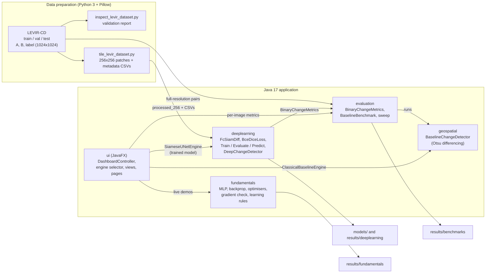
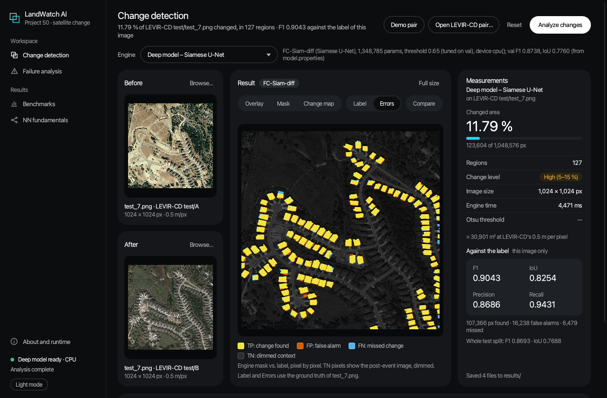
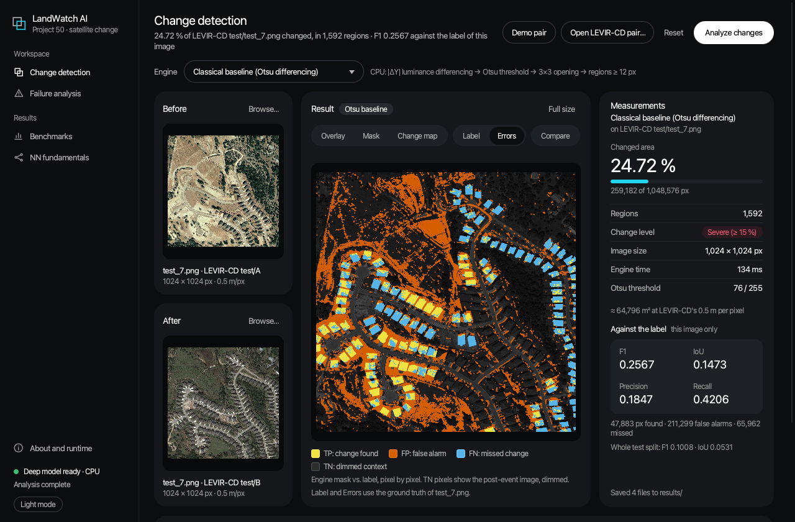
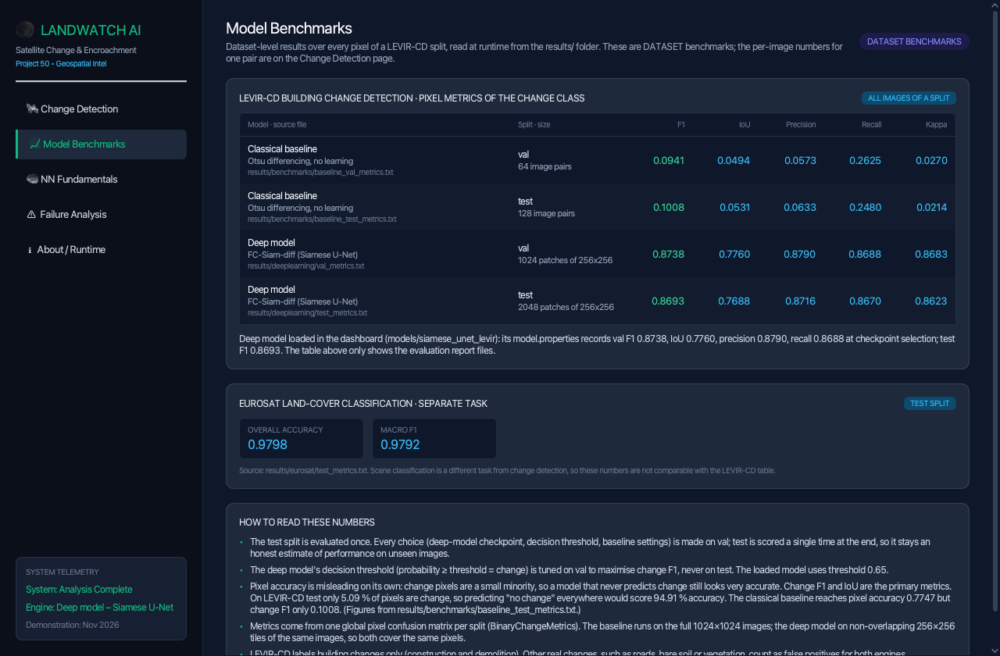

# LANDWATCH AI

**Multitemporal satellite change detection in Java 17.** A classical image-processing baseline, neural-network fundamentals written from scratch, a Siamese deep change-detection network (FC-Siam-diff) trained with DJL, and a JavaFX dashboard.

Academic project for **Problem Statement 50**: geospatial intelligence, multitemporal satellite image analysis, land-use and building-change detection.

Team: _add names here_

LANDWATCH AI takes two co-registered images of the same place, taken on different dates, and produces a per-pixel binary change mask. Change detection is evaluated on **LEVIR-CD**, a public building-change benchmark (637 Google Earth image pairs of 1024×1024 px at 0.5 m/pixel), which this project validates and tiles into 10,192 verified 256×256 patch triplets. The repository contains a reproducible data pipeline, a classical luminance-differencing baseline with Otsu thresholding benchmarked on the official validation and test splits, a plain-Java implementation of the multilayer perceptron, backpropagation, four optimisers, gradient checking and six classic learning rules, an FC-Siam-diff network (Daudt, Le Saux & Boulch, ICIP 2018) trained in Java through DJL's PyTorch engine on CPU or Apple MPS, and a desktop dashboard. The full academic write-up is in **[REPORT.md](REPORT.md)**.

---

## Key results

LEVIR-CD, pixel-level metrics for the *change* class from one global confusion matrix over the whole split. Values are copied from the result files (4 decimals, as printed there). The baseline runs on the full 1024×1024 images and the deep model on their 256×256 tiles; both cover exactly the same pixels (the test split has 6,837,404 true change pixels in both evaluations).

| Model | Split | Change F1 | Change IoU | Precision | Recall | Cohen's κ | Source |
|---|---|---|---|---|---|---|---|
| Classical baseline (luminance difference + Otsu, `minRegionSize` = 12) | val (64 pairs) | 0.0941 | 0.0494 | 0.0573 | 0.2625 | 0.0270 | `results/benchmarks/baseline_val_metrics.txt` |
| Classical baseline (same, untouched defaults) | **test** (128 pairs) | 0.1008 | 0.0531 | 0.0633 | 0.2480 | 0.0214 | `results/benchmarks/baseline_test_metrics.txt` |
| FC-Siam-diff (DJL, threshold 0.80 tuned on val) | val (1,024 patches) | 0.8554 | 0.7473 | 0.8548 | 0.8559 | 0.8490 | `results/deeplearning/val_metrics.txt` |
| FC-Siam-diff (same model, evaluated once) | **test** (2,048 patches) | **0.8548** | **0.7465** | 0.8600 | 0.8497 | 0.8471 | `results/deeplearning/test_metrics.txt` |

On the held-out test split the trained Siamese network raises change F1 from 0.1008 to 0.8548 and IoU from 0.0531 to 0.7465. Its val and test scores differ by only 0.0006 F1, so tuning the checkpoint and threshold on val did not overfit.

Neural-network fundamentals (plain Java, no libraries):

| Check | Result | Source |
|---|---|---|
| XOR with a 2-4-1 sigmoid MLP, backpropagation + SGD | mean loss 0.139816 → 0.000043 (99.97 % reduction); outputs 0.0053 / 0.9917 / 0.9913 / 0.0130 for targets 0 / 1 / 1 / 0 | `results/fundamentals/xor_and_gradient_check_output.txt` |
| Gradient check (central differences, 2-3-1 network) | 13 of 13 parameters pass; max relative error 9.00e-10 (tolerance 1.00e-05) | `results/fundamentals/xor_and_gradient_check_output.txt` |
| Learning-rules demo (seed 42) | Oja: \|w\| = 1.0004, 0.17° from the principal eigenvector; LMS recovers w = [2.0000, −3.0000, 0.5000], b = 1.0000; a single perceptron cannot learn XOR (25 % at the end, 50 % best) | `results/fundamentals/learning_rules_demo_output.txt` |

---

## Features

- **Verified data pipeline (Python).** Inspection and tiling of LEVIR-CD with a dry run by default, full decoding of every image, identical crop boxes for A, B and label, staging in a `.incomplete` folder, pixel-for-pixel verification of all 30,576 written files and automatic clean-up on failure.
- **Classical baseline (Java).** BT.601 luminance → absolute difference → per-image Otsu threshold → 3×3 morphological opening → 8-connected components (≥ 12 px) → bounding boxes. No training data.
- **Honest evaluation.** One global pixel confusion matrix; precision, recall, F1, IoU, macro-F1, mean IoU, Cohen's κ; pixel accuracy is shown only with a warning. Parameter exploration runs on val only (the sweep refuses the test split), and the deep-model evaluator refuses to overwrite an existing test report.
- **Neural-network fundamentals from scratch.** McCulloch–Pitts and sigmoid neurons, dense layers, MLP, backpropagation, SGD / batch GD / momentum / Nesterov (true lookahead gradient), central-difference gradient checking.
- **Classic learning rules.** Hebbian, Oja, competitive (winner-take-all), perceptron, LMS (Widrow–Hoff) and a small Boltzmann machine trained with Gibbs sampling.
- **Deep change detection (DJL + PyTorch).** FC-Siam-diff with a shared encoder and |enc(A) − enc(B)| skip connections (1,348,785 trainable parameters), weighted BCE + soft Dice loss, D4 flip/rotation augmentation, train-only normalisation, a decision threshold tuned on val, and tiled inference with mirror padding for images of any size. Runs on CPU or the Apple-silicon GPU (MPS).
- **Land-use classification (DJL).** A ResNet-18-style classifier trained on EuroSAT (10 classes, Sentinel-2 RGB), with a K×K confusion matrix and per-class metrics (`MulticlassMetrics`), training/evaluation/prediction CLIs and an inference API.
- **JavaFX dashboard.** Choose between the classical baseline and the trained deep model (loaded in the background) and run either on the same pair. Views: binary mask, red overlay and thematic change map, plus ground truth and an error map (TP / FP / FN) when a real LEVIR-CD pair is loaded. Per-image F1 / IoU / precision / recall against ground truth, pixel statistics, an audit log and export of every run. Sidebar pages: Model Benchmarks (read from the result files at runtime), NN Fundamentals (runs XOR, the gradient check and the learning-rules demo live), Failure Analysis (the baseline's worst test images) and About / Runtime.

---

## Architecture



Every dashboard engine returns only a binary mask; all views, statistics and exports are derived from that mask, so a new engine plugs in without UI changes. The deep engine (`SiameseUNetEngine`) loads `models/siamese_unet_levir` (override with `-Dlandwatch.model.dir=...`) on a background thread. If the model is missing or fails to load it stays disabled and says exactly why; it never produces simulated output.

---

## Repository structure

```
.
├── pom.xml                         Maven build: Java 17, JavaFX 17.0.10, JUnit 5.10.2, DJL 0.40.0 (PyTorch engine)
├── REPORT.md                       full academic project report
├── python_dataprep/
│   ├── inspect_levir_dataset.py    validates LEVIR-CD (counts, pairing, sizes, mask values)
│   ├── tile_levir_dataset.py       dry-run audit + safe, verified 256x256 tiling
│   └── generate_sample_satellite_pair.py   writes the SYNTHETIC demo pair
├── datasets/LEVIR-CD/              images are NOT in the repo; only text evidence is kept
│   ├── dataset_inspection_report.txt
│   ├── dataset_tiling_dryrun_report.txt
│   └── processed_256/
│       ├── preparation_report.txt
│       └── metadata/{train,val,test,all}_patches.csv
├── datasets/EuroSAT/               images NOT in the repo; dataset_summary.txt + splits/{train,val,test}.csv are
├── models/
│   ├── siamese_unet_levir/         trained FC-Siam-diff weights (5.4 MB) + model.properties
│   └── eurosat_resnet/             trained EuroSAT ResNet weights (11.2 MB) + model.properties
├── results/
│   ├── benchmarks/                 baseline val/test metrics, per-image CSVs, val-only minRegion sweep
│   ├── deeplearning/               training log, val threshold sweep, val/test metrics, device benchmark, test_7 example
│   ├── eurosat/                    training log, val/test metrics, confusion matrices, per-image predictions
│   ├── fundamentals/               XOR, gradient-check and learning-rules output
│   └── ui_snapshots/               dashboard screenshots
└── src/
    ├── main/java/com/landwatch/
    │   ├── fundamentals/           math, neurons, mlp, backprop, optimizers, gradientcheck, learningrules
    │   ├── geospatial/             classical baseline, image loading, visualisation
    │   ├── evaluation/             metrics, LEVIR-CD reader, baseline benchmark and sweep
    │   ├── deeplearning/           FC-Siam-diff, loss, data pipeline, training/evaluation/prediction CLIs;
    │   │                           eurosat/ = EuroSAT ResNet classifier
    │   └── ui/                     JavaFX dashboard, engines, export
    ├── main/resources/com/landwatch/
    │   ├── sample_data/siteA_{pre,post}.bmp   SYNTHETIC demo pair (not satellite imagery)
    │   └── ui/                     FXML view and CSS theme
    └── test/java/com/landwatch/    JUnit 5 tests mirroring the main packages
```

Created locally when you run the tools (not part of the repository): the `datasets/LEVIR-CD/{train,val,test}` and `processed_256/{train,val,test}` image folders, the EuroSAT images under `datasets/EuroSAT/`, and per-run dashboard exports `results/landwatch_*`. The trained model **is** included, so the dashboard's deep engine works right after cloning.

---

## Prerequisites

| Tool | Version | Used for |
|---|---|---|
| JDK | 17 | everything in Java (the build targets `--release 17`) |
| Maven | 3.9+ | build, tests, running the app |
| Python 3 | with Pillow | dataset inspection and tiling |

- On first use, DJL downloads the native PyTorch library (libtorch, about 200 MB) into `~/.djl.ai`. This happens on the first deep-learning test or command, so the first run needs an internet connection.
- On Apple-silicon Macs the deep model can use the GPU through PyTorch's MPS backend (`--device auto` picks MPS when it works, otherwise CPU).

```bash
python3 -m pip install Pillow
```

---

## Datasets: download and preparation

The images are not redistributed in this repository.

### LEVIR-CD (building change detection)

1. Download LEVIR-CD from the official page: <https://justchenhao.github.io/LEVIR/> (research use).
2. Unpack it so that the official splits sit here:
   ```
   datasets/LEVIR-CD/train/{A,B,label}/
   datasets/LEVIR-CD/val/{A,B,label}/
   datasets/LEVIR-CD/test/{A,B,label}/
   ```
3. Inspect, audit and tile (run from the project root):
   ```bash
   python3 python_dataprep/inspect_levir_dataset.py            # writes datasets/LEVIR-CD/dataset_inspection_report.txt
   python3 python_dataprep/tile_levir_dataset.py               # dry run only: writes the audit report, creates nothing
   python3 python_dataprep/tile_levir_dataset.py --execute     # writes datasets/LEVIR-CD/processed_256/
   ```
   The tiler refuses to start if there is any validation error, if the output folder (or a leftover `.incomplete` folder) exists, or if disk space is short. Expected result: 637 triplets → 10,192 patch triplets → 30,576 files (`datasets/LEVIR-CD/processed_256/preparation_report.txt`).

The deep-learning tools find the patches at `datasets/LEVIR-CD/processed_256` relative to the working directory, or wherever the `LEVIR_CD_ROOT` environment variable or the `-Dlandwatch.levir.root=...` system property points.

### EuroSAT (land-use classification)

1. Download `EuroSAT_RGB.zip` from Zenodo record 7711810: <https://zenodo.org/records/7711810> (project page: <https://github.com/phelber/EuroSAT>).
2. Unzip it into `datasets/EuroSAT/` so that the images are at `datasets/EuroSAT/EuroSAT_RGB/<Class>/<Class>_<n>.jpg` (27,000 JPEGs). Check the archive's MD5 against the value on the Zenodo record.
3. The committed split in `datasets/EuroSAT/splits/` is used as is. To recreate it (stratified 70/15/15, seed 42), run `java -cp "$CP" com.landwatch.deeplearning.eurosat.EuroSatSplit --root datasets/EuroSAT --seed 42`, with `CP` set up as in "Deep model" below.

---

## How to run

All commands are run from the project root.

### Tests

```bash
# macOS
JAVA_HOME=$(/usr/libexec/java_home -v 17) mvn clean test
# any OS, with JDK 17 on the PATH
mvn clean test
```

Expected result: **243 tests, 0 failures** (Java 17.0.21.1, Apple M3, with the LEVIR-CD patches present). By area: fundamentals 59, learning rules 44, classical baseline and visualisation 18, evaluation 29, LEVIR-CD deep learning 28, EuroSAT 19, dashboard 46.

Tests that read real LEVIR-CD patches are skipped automatically (JUnit assumptions) when `datasets/LEVIR-CD/processed_256` is not present. The deep-learning tests need the PyTorch native library, which DJL downloads on the first run.

### Dashboard

```bash
mvn javafx:run
```

- **Real data:** click **Load LEVIR-CD Pair…** and pick any image in `datasets/LEVIR-CD/test/A` (or `B`/`label`). A, B and the ground-truth label load together. Choose an engine, click **Analyze Changes**, and switch to the **Ground Truth** and **Errors vs GT** views. The per-image F1 / IoU / precision / recall appear next to the engine's dataset benchmark. Switch engines and analyse again to compare the classical baseline and the deep model on the same pair.
- **Demo:** **Load Demo Pair** loads the bundled pair (`src/main/resources/com/landwatch/sample_data/siteA_*.bmp`). It is a **synthetic, computer-generated 400×300 scene, not satellite imagery**, and has no ground truth.
- **Your own images:** **Browse Before...** / **Browse After...** accept any co-registered pair of equal size (PNG, JPG, BMP or TIFF).
- Options: `mvn javafx:run -Dlandwatch.model.dir=<dir> -Dlandwatch.deeplearning.device=cpu|mps|auto -Dlandwatch.dataset.dir=<LEVIR-CD dir>`.

### Classical baseline benchmark (needs the full-resolution LEVIR-CD images)

```bash
mvn -B compile
java -Xmx2g -cp target/classes com.landwatch.evaluation.BaselineBenchmark val  datasets/LEVIR-CD results/benchmarks
java -Xmx2g -cp target/classes com.landwatch.evaluation.BaselineBenchmark test datasets/LEVIR-CD results/benchmarks
# val-only exploration of the minimum region size (refuses to run on test)
java -Xmx2g -cp target/classes com.landwatch.evaluation.BaselineMinRegionSweep val datasets/LEVIR-CD results/benchmarks
```

### Deep model: training, evaluation, prediction (needs `processed_256`)

The deep-learning classes need the DJL jars on the classpath. One way:

```bash
mvn -q compile dependency:build-classpath -Dmdep.outputFile=target/classpath.txt
CP="target/classes:$(cat target/classpath.txt)"

# Train on TRAIN, pick checkpoint and threshold on VAL (options shown with their default values)
java -cp "$CP" com.landwatch.deeplearning.TrainChangeDetector \
    --data datasets/LEVIR-CD/processed_256 --out models/siamese_unet_levir --results results/deeplearning \
    --epochs 14 --batch 8 --lr 1e-3 --device auto --workers 4 --max-minutes 72 \
    --seed 42 --pos-weight auto --dice-weight 1

# Evaluate: val as often as you like, test once with the final model
java -cp "$CP" com.landwatch.deeplearning.EvaluateChangeDetector val
java -cp "$CP" com.landwatch.deeplearning.EvaluateChangeDetector test

# Predict a change mask (and optionally a probability map) for any equal-size image pair
java -cp "$CP" com.landwatch.deeplearning.PredictChangeMap before.png after.png mask.png \
    --model models/siamese_unet_levir --device auto --probability-out probability.png

# Optional: CPU vs Apple MPS training-step benchmark on a synthetic batch [batch] [steps] [patch]
java -cp "$CP" com.landwatch.deeplearning.DeviceBenchmark 8 12 256
```

- `TrainChangeDetector` also accepts `--train-limit N` / `--val-limit N` for quick smoke runs. It writes `models/siamese_unet_levir/` (weights + `model.properties` with architecture, normalisation, threshold, hyper-parameters, versions) and `results/deeplearning/training_log.csv` and `val_threshold_sweep.csv`.
- `EvaluateChangeDetector <val|test|train>` accepts `--model`, `--data`, `--results`, `--device auto|cpu|mps`, `--limit N`, `--cpu-latency-patches N` (default 50) and `--force true`. It writes `results/deeplearning/<split>_metrics.txt` and refuses to overwrite an existing `test_metrics.txt` unless `--force true` is given.

### EuroSAT classifier: training, evaluation, prediction (needs `datasets/EuroSAT`)

```bash
# CP as above (target/classes + the dependency classpath)
java -Xmx1500m -cp "$CP" com.landwatch.deeplearning.eurosat.TrainEuroSatClassifier \
    --data datasets/EuroSAT --epochs 20 --batch 64 --lr 1e-3 --device auto --seed 42 --max-minutes 30
java -cp "$CP" com.landwatch.deeplearning.eurosat.EvaluateEuroSatClassifier val  --device cpu
java -cp "$CP" com.landwatch.deeplearning.eurosat.EvaluateEuroSatClassifier test --device cpu   # once; refuses to overwrite without --force true
java -cp "$CP" com.landwatch.deeplearning.eurosat.PredictEuroSatClass tile.jpg --device cpu
```

Defaults: `--model models/eurosat_resnet`, `--results results/eurosat`, `--splits datasets/EuroSAT/splits`.

### Neural-network fundamentals

```bash
mvn -B compile
java -cp target/classes com.landwatch.fundamentals.learningrules.LearningRulesDemo   # Hebbian, Oja, competitive, perceptron, LMS, Boltzmann
mvn test -Dtest=BackpropagationEngineTest,GradientCheckerTest                      # XOR training + gradient check output
```

---

## Results summary

### Classical baseline on LEVIR-CD

Source: `results/benchmarks/baseline_val_metrics.txt` and `results/benchmarks/baseline_test_metrics.txt` (global pixel confusion matrix, label value > 0 = change, `minRegionSize` = 12, untouched default).

| Split | Pairs | TP | FP | FN | TN | Precision | Recall | F1 | IoU | Macro F1 | κ | Pixel acc. |
|---|---|---|---|---|---|---|---|---|---|---|---|---|
| val | 64 | 739,170 | 12,159,023 | 2,077,098 | 52,133,573 | 0.0573 | 0.2625 | 0.0941 | 0.0494 | 0.4870 | 0.0270 | 0.7879 |
| test | 128 | 1,695,603 | 25,101,718 | 5,141,801 | 102,278,606 | 0.0633 | 0.2480 | 0.1008 | 0.0531 | 0.4860 | 0.0214 | 0.7747 |

The baseline flags 19.9656 % of test pixels as change while only 5.0943 % truly changed, so most detections are false alarms: illumination, shadows, vegetation and registration offsets all change brightness. A val-only sweep of the minimum region size (`results/benchmarks/baseline_val_minregion_sweep.txt`) moves val F1 only between 0.0937 and 0.0990, so post-processing cannot fix the underlying signal. No swept value was run on test.

### Deep model (FC-Siam-diff) on LEVIR-CD

Sources: `results/deeplearning/{training_log.csv, val_threshold_sweep.csv, val_metrics.txt, test_metrics.txt, device_benchmark.txt}` and `models/siamese_unet_levir/model.properties`.

**Training run.** All 7,120 train patches, batch 8, Adam (lr 1e-3, cosine decay), weighted BCE (pos_weight 4.56) + soft Dice, D4 augmentation, seed 42, on the Apple M3 GPU (MPS) via DJL 0.40.0 / PyTorch 2.7.1. The run stopped after 7 of 13 planned epochs when its 75-minute time budget ran out (67.0 min). Val F1 was still rising, so the model is under-trained rather than converged.

| Epoch | Train loss | Val F1 (tuned t) | Val IoU | Best threshold |
|---|---|---|---|---|
| 1 | 0.81993 | 0.7477 | 0.5970 | 0.55 |
| 2 | 0.58860 | 0.7813 | 0.6411 | 0.55 |
| 3 | 0.49564 | 0.8135 | 0.6857 | 0.75 |
| 4 | 0.43725 | 0.8177 | 0.6916 | 0.40 |
| 5 | 0.39443 | 0.8348 | 0.7164 | 0.45 |
| 6 | 0.36595 | 0.8469 | 0.7345 | 0.80 |
| **7** (selected) | 0.33654 | **0.8554** | **0.7473** | **0.80** |

**Final evaluation** (epoch-7 checkpoint, threshold 0.80; the test split was evaluated exactly once):

| Split | TP | FP | FN | TN | Precision | Recall | F1 | IoU | Macro F1 | κ | Pixel acc. |
|---|---|---|---|---|---|---|---|---|---|---|---|
| val | 2,410,469 | 409,387 | 405,799 | 63,883,209 | 0.8548 | 0.8559 | 0.8554 | 0.7473 | 0.9245 | 0.8490 | 0.9879 |
| test | 5,809,506 | 945,411 | 1,027,898 | 126,434,913 | 0.8600 | 0.8497 | 0.8548 | 0.7465 | 0.9235 | 0.8471 | 0.9853 |

At the untuned threshold 0.50, test F1 would be 0.8479, so the val-tuned threshold adds about 0.007 F1. F1 is flat (0.8546–0.8554) for thresholds 0.70–0.85.

**Speed.**
- Training: one step at batch 8 takes 351.3 ms on MPS against 2,456.0 ms on CPU, about 7× faster. CPU and MPS logits for the same weights differ by at most 1.5e-4.
- Inference: during the test run, the median per 256×256 patch was 55.4 ms on MPS and 53.3 ms on CPU over 50 patches. A full 1024×1024 image (16 tiles) took 506 ms on MPS.
- These timings were measured while other jobs loaded the machine and are indicative only.

**Example image** (`results/deeplearning/examples/`, LEVIR-CD `test_7`, full 1024×1024 via tiled inference): F1 0.8938, IoU 0.8080 on this single image. It is one illustration, already counted inside the test score above, not a separate result.

### Baseline vs. deep model (LEVIR-CD test)

| | Classical baseline | FC-Siam-diff | Change |
|---|---|---|---|
| Change F1 | 0.1008 | 0.8548 | +0.7540 |
| Change IoU | 0.0531 | 0.7465 | +0.6934 |
| Precision | 0.0633 | 0.8600 | +0.7967 |
| Recall | 0.2480 | 0.8497 | +0.6017 |
| Cohen's κ | 0.0214 | 0.8471 | +0.8257 |
| Pixels flagged as change | 26,797,321 (19.97 %) | 6,754,917 (5.03 %) | true change: 6,837,404 (5.09 %) |

The baseline flags about four times as many pixels as truly changed, and about 94 % of its detections are false alarms. The learned model flags almost exactly the true amount of change, and 86 % of its detections are correct. Learned bi-temporal features separate building change from illumination, season and registration noise far better than a fixed brightness-difference rule.

### EuroSAT land-use classification

A separate task: scene classification of single 64×64 Sentinel-2 RGB tiles (10 m GSD) into 10 land-use / land-cover classes. It is **not** change detection and is not applied to LEVIR-CD images.

Sources: `results/eurosat/{training_log.csv, val_metrics.txt, test_metrics.txt, confusion_matrix_test.csv}`, `models/eurosat_resnet/model.properties` and `datasets/EuroSAT/dataset_summary.txt`.

**Setup.**
- **Split:** stratified 70/15/15 with seed 42, giving 18,900 train, 4,050 val and 4,050 test images. The split is committed in `datasets/EuroSAT/splits/`.
- **Model:** a ResNet-18-style network adapted to 64×64 inputs (3×3 stem, no max-pool, stages of 32-64-128-256 channels, 2,797,610 parameters).
- **Training:** 20 epochs, Adam with lr 1e-3 and cosine decay, batch 64, D4 augmentation, 26.8 min on MPS.
- **Selection:** the epoch with the best val accuracy (19); test evaluated once.

| Split | Images | Correct | Overall accuracy | Macro F1 | Macro precision | Macro recall |
|---|---|---|---|---|---|---|
| val | 4,050 | 3,939 | 0.9726 | 0.9716 | 0.9722 | 0.9713 |
| **test** | 4,050 | 3,968 | **0.9798** | **0.9792** | 0.9794 | 0.9791 |

| Class | Test F1 | Class | Test F1 |
|---|---|---|---|
| AnnualCrop | 0.9767 | Pasture | 0.9699 |
| Forest | 0.9911 | PermanentCrop | 0.9573 |
| HerbaceousVegetation | 0.9648 | Residential | 0.9911 |
| Highway | 0.9881 | River | 0.9812 |
| Industrial | 0.9800 | SeaLake | 0.9922 |

The most frequent test confusions are between visually similar vegetation classes: PermanentCrop → HerbaceousVegetation (10 images), HerbaceousVegetation → PermanentCrop (6) and Pasture → HerbaceousVegetation (6).

The split is random, so tiles from the same region can fall into different splits. These numbers may therefore overstate performance on unseen regions, and they are not directly comparable with published EuroSAT results, which use other splits.

### Dashboard

All screenshots are rendered from the real application by `DashboardSnapshotTool` (`results/ui_snapshots/`). The per-image numbers apply to that one image only.

**Deep model on a real LEVIR-CD test pair (`test_7`): error map against ground truth.** Yellow = correctly detected change, orange = false alarm, blue = missed change. Per-image F1 is 0.8938, shown next to the dataset benchmark of 0.8548.



**Classical baseline on the same pair.** Per-image F1 0.2567: most detections are false alarms.



**Model Benchmarks page.** Every value is read from `results/` at runtime.



More views: [red overlay](results/ui_snapshots/03_levir_test_7_deep_overlay.png), [ground truth](results/ui_snapshots/04_levir_test_7_deep_ground_truth.png), [synthetic demo pair](results/ui_snapshots/01_demo_synthetic_classical_overlay.png), [NN fundamentals](results/ui_snapshots/11_page_nn_fundamentals_learning_rules.png), [failure analysis](results/ui_snapshots/12_page_failure_analysis.png), [about / runtime](results/ui_snapshots/13_page_about_runtime.png).

---

## Limitations

- **LEVIR-CD labels building changes only** (construction and demolition). Results on it say nothing about deforestation, roads, water or general land-use change; such genuine changes count as false positives under its labels.
- **The classical baseline** reacts to any brightness difference: illumination, sun angle, season, haze and small registration errors all produce false positives, and Otsu always splits the histogram, even when nothing changed.
- **FC-Siam-diff is order-symmetric.** Its decoder only sees |enc(A) − enc(B)|, so swapping the two dates gives the same output (checked in inference mode by `FcSiamDiffTest`): it cannot tell construction from demolition.
- **No ground-sample-distance calibration** exists for arbitrary inputs. The dashboard reports areas in pixels only, and its "change level" is a heuristic based on the share of changed pixels, not a verified assessment.
- **The bundled demo pair is synthetic**, not real satellite imagery.
- **Training is not bit-reproducible.** Augmentation draws from an unseeded `ThreadLocalRandom`, and GPU (MPS) kernels are not guaranteed deterministic. The deep-model results come from a single training run; there is no variance estimate over seeds.
- **Deviations from the FC-Siam-diff paper:** nearest-neighbour upsampling + 3×3 convolution instead of transposed convolution (DJL 0.40's PyTorch engine lacks the deconvolution operator), no dropout, an |A − B| bottleneck, and BatchNorm statistics shared across both dates.
- **XOR training only shows that backpropagation works.** It is not evidence about training satellite models. The recorded XOR losses also differ slightly from those first reported on the original Windows laptop (see `results/fundamentals/xor_and_gradient_check_output.txt`).
- Latencies were measured on a busy 8 GB laptop and are indicative only.

---

## Datasets, licences and credits

- **LEVIR-CD**: H. Chen and Z. Shi, "A Spatial-Temporal Attention-Based Method and a New Dataset for Remote Sensing Image Change Detection", *Remote Sensing* 12(10):1662, 2020. Google Earth imagery, 0.5 m/pixel, 637 pairs of 1024×1024 px spanning 5–14 years (2002–2018), 31,333 annotated building-change instances. Distributed by its authors for research use: <https://justchenhao.github.io/LEVIR/>. Images are not redistributed here; only our derived text reports and patch metadata are.
- **EuroSAT**: P. Helber, B. Bischke, A. Dengel and D. Borth, "EuroSAT: A Novel Dataset and Deep Learning Benchmark for Land Use and Land Cover Classification", *IEEE JSTARS* 12(7), 2019. Sentinel-2, 27,000 labelled 64×64 patches in 10 classes (RGB version used). Zenodo record 7711810, MIT licence. <https://github.com/phelber/EuroSAT>
- **FC-Siam-diff**: R. Caye Daudt, B. Le Saux and A. Boulch, "Fully Convolutional Siamese Networks for Change Detection", ICIP 2018. Re-implemented here in Java with DJL and trained from scratch.
- **Software**: OpenJFX, Deep Java Library (DJL) with the PyTorch engine, JUnit 5, Apache Maven, Pillow. Each is used under its own licence.
- **Code licence**: no LICENSE file has been added to this repository yet.

To cite the methods behind this project, see the reference list in [REPORT.md](REPORT.md#14-references).
