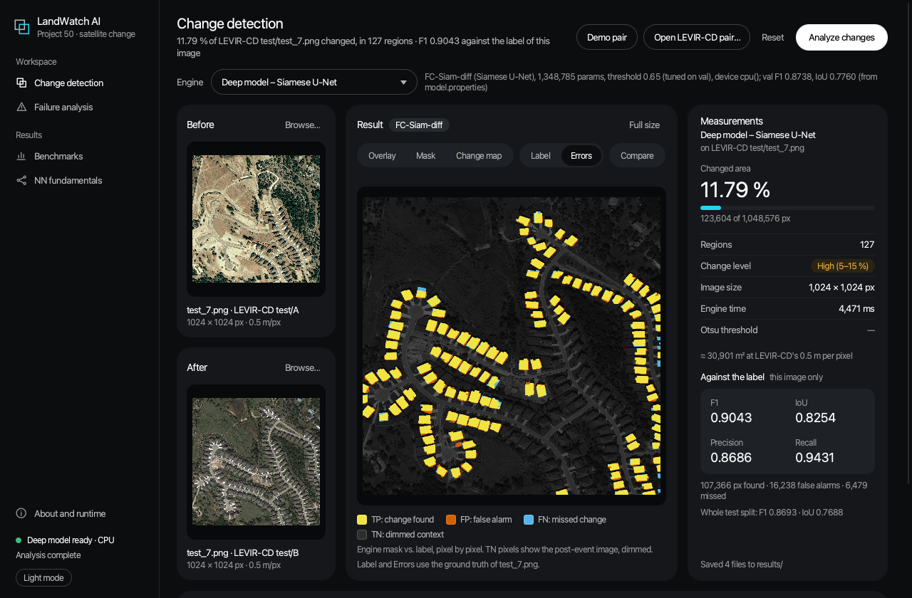
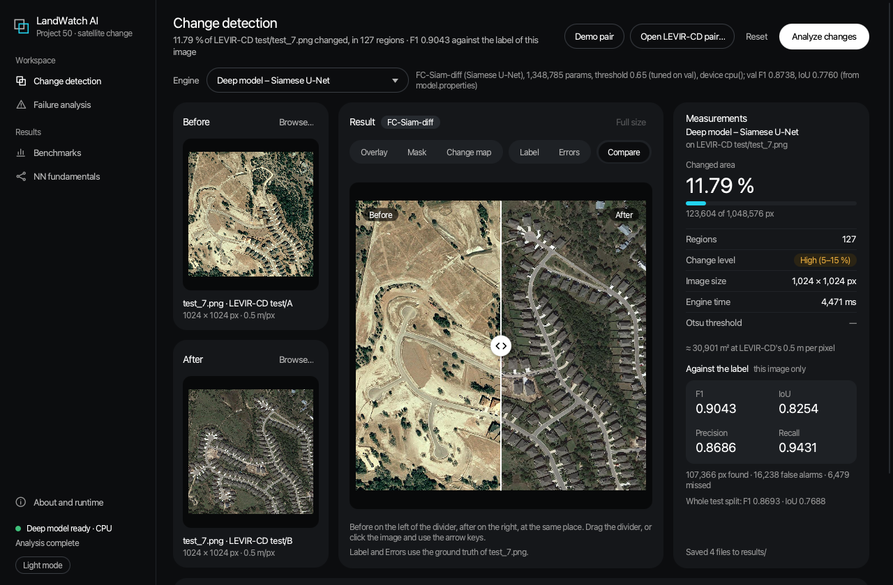
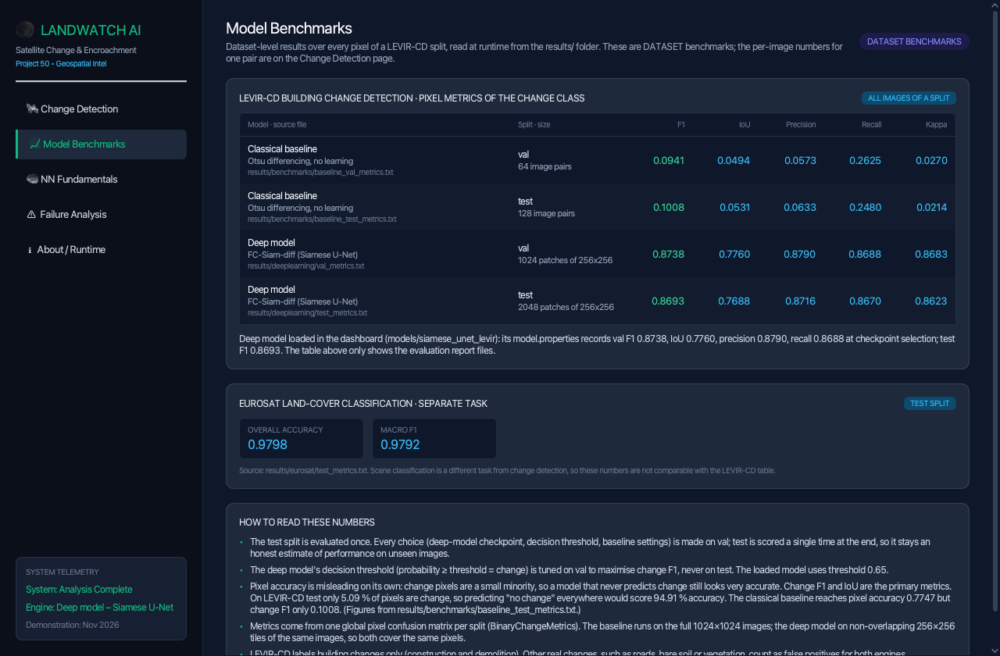

# LANDWATCH AI: Multitemporal Satellite Change Detection in Java

**Project report, Problem Statement 50** (geospatial intelligence: multitemporal satellite image analysis, land-use and building-change detection)

Team: _add names here_

November 2026

---

## Contents

1. [Abstract](#1-abstract)
2. [Introduction and problem statement](#2-introduction-and-problem-statement)
3. [Objectives](#3-objectives)
4. [Related work](#4-related-work)
5. [Datasets](#5-datasets)
6. [Methodology](#6-methodology)
7. [Evaluation methodology](#7-evaluation-methodology)
8. [Results](#8-results)
9. [The JavaFX dashboard](#9-the-javafx-dashboard)
10. [Software engineering](#10-software-engineering)
11. [Limitations and threats to validity](#11-limitations-and-threats-to-validity)
12. [Future work](#12-future-work)
13. [Conclusion](#13-conclusion)
14. [References](#14-references)
- [Appendix A. Reproducing every result](#appendix-a-reproducing-every-result)

**Conventions.** Every number in this report is copied from a file in the repository, and every results table names its source file. Metric values are given with the 4 decimals printed in those files unless stated otherwise. A few numbers are *derived* from repository files (for example a median over a per-image CSV); these are marked "computed from" with the file name. References are given as [n] and listed in Section 14.

---

## 1. Abstract

Change detection compares two co-registered images of the same area taken at different times and marks the pixels where something changed. LANDWATCH AI is a change-detection system written in Java 17. We validated the LEVIR-CD building-change benchmark (637 image pairs of 1024×1024 px at 0.5 m/pixel) and tiled it into 10,192 verified 256×256 patch triplets. In doing so we found that 32 of the 637 official masks contain stray non-binary values. On top of this data we implemented three things. The first is a classical baseline: luminance differencing, Otsu thresholding and morphological post-processing. The second is the fundamentals of neural networks, written from scratch: neurons, a multilayer perceptron, backpropagation, four optimisers, gradient checking and six classic learning rules. The third is the FC-Siam-diff fully convolutional Siamese network, trained in Java through the Deep Java Library (DJL) with the PyTorch engine. Its loss is designed for the 4.65 % share of change pixels, and its decision threshold is tuned on validation data only. A JavaFX dashboard runs a detection engine on a user-supplied image pair and shows three views of the result. On the held-out LEVIR-CD test split, the classical baseline reaches a change-class F1 of 0.1008 and an IoU of 0.0531 while flagging almost four times as many pixels as truly changed. FC-Siam-diff, trained for its full 13-epoch schedule (83 minutes on an Apple M3 GPU) and evaluated once on the same test pixels, reaches a change-class F1 of 0.8693 and an IoU of 0.7688, with precision 0.8716 and recall 0.8670. Its validation F1 of 0.8738 is within 0.0045 of the test score. An earlier run that stopped after 7 epochs (test F1 0.8548) is reported alongside it; the final model was chosen between the two runs on validation F1 alone. The trained model is also integrated into the dashboard, where both engines can be compared on real LEVIR-CD pairs against ground truth. All results are produced by code in the repository.

---

## 2. Introduction and problem statement

### 2.1 Background

Satellite and aerial images of the same place, taken years apart, record how land is used: new buildings appear, fields are cleared, roads are built. Detecting these changes automatically is a basic task of geospatial intelligence. It supports urban-growth monitoring, damage assessment and the enforcement of planning rules. The input is a *bi-temporal* (or, more generally, multitemporal) image pair. The output is a *change map*: a label for every pixel saying whether it changed.

The task is harder than it looks. Two images of the same place differ even when nothing on the ground has changed. Sun angle and shadows differ, vegetation changes with the season, haze and sensor settings shift the colours, and the images are never perfectly aligned. Real changes, in contrast, are rare. In LEVIR-CD only 4.65 % of the pixels are labelled as changed (Section 5.1). A method must therefore ignore large *irrelevant* differences while finding small *relevant* ones, and it must be evaluated with metrics that are not fooled by the imbalance (Section 7).

### 2.2 Problem statement

**Change detection.** Given a "before" image $A$ and an "after" image $B$ of the same site, co-registered and of equal size $H \times W$, produce a binary mask $M \in \lbrace 0,1 \rbrace^{H \times W}$ with $M(x,y) = 1$ where the scene changed. On LEVIR-CD, "changed" means *a building appeared or disappeared*, because that is what its labels encode.

**Land-use classification.** Given a single small image patch, assign it one of a fixed set of land-use or land-cover classes. This is the EuroSAT task (Section 5.3).

### 2.3 Scope: what this report claims and what it does not

- The learned change-detection model is trained and evaluated on **LEVIR-CD, which labels building changes only**. No claim is made about detecting deforestation, roads, water or other land-use changes.
- The demo image pair bundled with the dashboard (`src/main/resources/com/landwatch/sample_data/siteA_*.bmp`) is **synthetic**, generated by `python_dataprep/generate_sample_satellite_pair.py`. It is **not satellite imagery** and no accuracy is claimed on it.
- The XOR experiment shows that the from-scratch backpropagation code is correct. It **does not show** that satellite models can be trained with that code; the satellite model is trained with DJL.
- There is **no ground-sample-distance (GSD) calibration** for arbitrary inputs, so areas are reported in pixels only.

---

## 3. Objectives

1. **O1 – Data.** Build a safe, verifiable pipeline that validates LEVIR-CD, documents its anomalies and tiles it into patches without ever modifying the source data.
2. **O2 – Classical baseline.** Implement a non-learned change detector and benchmark it honestly on the official validation and test splits, so that learned models have a reference point.
3. **O3 – Neural-network fundamentals.** Implement neurons, a multilayer perceptron, backpropagation and four optimisers in plain Java, and verify the gradients numerically.
4. **O4 – Learning rules.** Implement and demonstrate the classic learning rules: Hebbian, Oja, competitive, perceptron, LMS and Boltzmann.
5. **O5 – Deep change detection.** Train a Siamese fully convolutional network in Java on LEVIR-CD with strict train/validation/test separation, and run it on images of any size.
6. **O6 – Land-use classification.** Train a residual CNN on EuroSAT.
7. **O7 – Application.** Provide a desktop dashboard that runs a detection engine on a user's image pair, visualises the result and exports it, with honest wording.
8. **O8 – Engineering.** Automated tests, recorded environments and commands for every result, and rules that protect the data and the test split.

---

## 4. Related work

**Classical change detection.** The simplest family of methods computes a per-pixel difference between the two dates and thresholds it. A standard way to choose the threshold automatically is Otsu's method [4]. It picks the grey level that maximises the between-class variance of the histogram. Morphological filtering and connected-component analysis are then used to remove isolated noise. Such methods need no training data, but they respond to every radiometric difference, not only to semantic change.

**Deep change detection.** Daudt, Le Saux and Boulch [2] proposed three fully convolutional, U-Net-style [25] networks for change detection. FC-EF (early fusion) stacks both images as one input. FC-Siam-conc and FC-Siam-diff are Siamese: both images pass through one encoder with shared weights. FC-Siam-conc concatenates the two feature maps in the skip connections; FC-Siam-diff passes their absolute difference. We implement FC-Siam-diff because its difference skips build in the prior that "identical features mean no change", and because it is small enough to train on a laptop.

**Benchmarks.** Chen and Shi [1] introduced LEVIR-CD together with a spatial–temporal attention network (STANet). LEVIR-CD has 637 Google Earth image pairs of 1024×1024 px at 0.5 m/pixel, spanning 5 to 14 years between 2002 and 2018, with 31,333 annotated building-change instances. For land-use classification, Helber et al. [3] released EuroSAT: 27,000 labelled Sentinel-2 patches in 10 classes. Residual networks (ResNet) [5] are a standard architecture for such image classification.

**Neural-network fundamentals.** The project's fundamentals follow the textbook by Haykin [6]: the McCulloch–Pitts neuron [7], backpropagation [13], momentum [14] and Nesterov's accelerated gradient [15]. The learning rules are Hebb's postulate [8], Oja's rule [9], Rosenblatt's perceptron [10], the Widrow–Hoff LMS rule [11] and the Boltzmann machine learning rule of Ackley, Hinton and Sejnowski [12]. The deep model uses Adam [16], batch normalisation [17], He initialisation [18], a soft Dice loss in the spirit of V-Net [20] and cosine learning-rate decay [22]. It is evaluated with standard segmentation metrics and Cohen's kappa [21].

---

## 5. Datasets

### 5.1 LEVIR-CD

LEVIR-CD [1] is distributed by its authors for research use (<https://justchenhao.github.io/LEVIR/>). The images are **not** redistributed in this repository; only our derived text reports and patch metadata are. Each sample is a triplet: an earlier RGB image `A`, a later RGB image `B` and an 8-bit grayscale `label` mask, with an official train/val/test split.

**Validation of the local copy.** Source: `datasets/LEVIR-CD/dataset_inspection_report.txt` and `datasets/LEVIR-CD/dataset_tiling_dryrun_report.txt`.

| Split | A | B | label | Matched triplets | Size (px) | Image modes (A, B, label) |
|---|---|---|---|---|---|---|
| train | 445 | 445 | 445 | 445 | 1024 × 1024 | RGB, RGB, L |
| val | 64 | 64 | 64 | 64 | 1024 × 1024 | RGB, RGB, L |
| test | 128 | 128 | 128 | 128 | 1024 × 1024 | RGB, RGB, L |
| **total** | | | | **637** | | |

All files decoded successfully (0 corrupted). Every `A` has a matching `B` and `label` (0 missing counterparts), and A, B and label sizes agree in every triplet.

**Mask values: the 156/254 finding.** LEVIR-CD masks are meant to be binary, with 0 for no change and 255 for change. The tiling audit computed the *full histogram* of all 637 masks rather than only their minimum and maximum. Source: `datasets/LEVIR-CD/dataset_tiling_dryrun_report.txt`, Section 5.

| Mask value | Pixels | Share |
|---|---|---|
| 0 | 636,876,269 | 95.3489 % |
| 156 | 187 | 0.0000 % |
| 254 | 522 | 0.0001 % |
| 255 | 31,065,934 | 4.6510 % |

**32 of the 637 official masks** contain values other than 0 and 255. Examples from the report: `train/label/train_18.png` has 134 pixels of value 254, and `train/label/train_227.png` has 1 pixel of value 156. Their origin is unknown to us. Our policy is:

- **preserve** them: mask patches are copied unchanged, with no thresholding during tiling;
- **interpret** them with one rule everywhere: *any value > 0 means change*. This rule is applied in the patch metadata (`has_change`, `change_pixel_count`), in the Java readers (`LevirCdPairReader`, `ImageTensors.toBinaryMask`) and in all metrics.

The affected pixels (709 in total) are far too few to change any reported metric at 4 decimals, but the rule makes the behaviour explicit and testable (`LevirCdPairReaderTest`, `DataPipelineTest.anyNonZeroLabelValueIsChange`). In the patch metadata, 75 patches list the mask values `0;156;255` and 14 list `0;254;255` (computed from `datasets/LEVIR-CD/processed_256/metadata/all_patches.csv`).

**Class imbalance.** Change pixels make up 4.65 % of all mask pixels (value 255: 4.6510 %, plus the 709 stray pixels). At patch level, however, change is common: 4,538 of 10,192 patches (44.5 %) contain at least one change pixel. Source: `datasets/LEVIR-CD/processed_256/preparation_report.txt`.

| Split | Patches | Patches with change | Change-pixel share |
|---|---|---|---|
| train | 7,120 | 3,167 (44.5 %) | 4.589 % |
| val | 1,024 | 436 (42.6 %) | 4.197 % |
| test | 2,048 | 935 (45.7 %) | 5.094 % |

Patch counts are from the preparation report. The change-pixel shares are computed from the `change_pixel_count` column of `datasets/LEVIR-CD/processed_256/metadata/{train,val,test}_patches.csv`; for example, train has 21,412,971 change pixels in 7,120 × 65,536 pixels. The val and test totals (2,816,268 and 6,837,404 change pixels) match exactly the "true change pixels" counted independently by the Java baseline benchmark on the full-resolution images (`results/benchmarks/baseline_{val,test}_metrics.txt`). This is a useful cross-check between the Python and Java pipelines.

### 5.2 Tiling pipeline: safety and verification

A 1024×1024 pair is too large to train on comfortably on an 8 GB laptop. `python_dataprep/tile_levir_dataset.py` therefore cuts every triplet into a 4 × 4 grid of non-overlapping 256×256 patches: 16 patch triplets per image pair, with no padding and no resizing. The script is designed so that a mistake cannot damage the data or go unnoticed.

| Design rule | How it is enforced |
|---|---|
| Nothing is written by accident | Dry run by default; patches are written only with `--execute`. |
| Corrupt input is caught before writing | Every source image is fully decoded (`img.load()`); a missing split folder, a missing A/B/label folder or an incomplete triplet is a validation error, and execution refuses to start if any error exists. |
| A, B and label stay aligned | All three are cropped with the identical box; the official splits are kept separate. |
| Labels are not altered | Masks are cropped from the untouched original (no colour conversion), so every pixel value is preserved. |
| Anomalies are reported | The set of mask values comes from the full histogram of every mask. |
| No partial output | Patches are written to `processed_256.incomplete` and renamed to `processed_256` only after every file is written and verified. On failure or interruption only that new folder is removed; source images are never modified. |
| No overwriting | The script refuses to run if the output folder or a leftover `.incomplete` folder exists. |
| Enough disk space | The output size is estimated per file (size / patches × 1.08, rounded up to 4 KB) and 50 % more free space than that estimate is required. |
| The report describes reality | The preparation report counts the files actually on disk. |

**Verification results.** Source: `datasets/LEVIR-CD/dataset_tiling_dryrun_report.txt` and `datasets/LEVIR-CD/processed_256/preparation_report.txt`.

| Quantity | Value |
|---|---|
| Source triplets | 637 (445 / 64 / 128) |
| Patch triplets | 10,192 (7,120 / 1,024 / 2,048) |
| Patch image files on disk | 30,576 |
| Files re-opened and matched pixel for pixel with their crop | 30,576 of 30,576 |
| File names vs. metadata CSVs | exact match (none missing, none extra) |
| Validation errors / warnings | 0 / 0 |
| Source images (validated) | 2357.90 MB |
| Estimated / actual patch size on disk | 2626.30 MB / 2264.9 MB |
| Audit time / tiling time | 25.86 s / 121.4 s |

In addition, the generated patches were **independently re-verified pixel by pixel** with a separate NumPy script, which found no problems.

The metadata files `processed_256/metadata/{train,val,test,all}_patches.csv` have one row per patch triplet and 19 columns: the patch file name, the relative paths of A, B and label, the original file name, the split, the patch index, row and column, the crop box (`x1, y1, x2, y2`), the patch width and height, `has_change`, `change_pixel_count`, `change_ratio` and the distinct `mask_values`. The Java data loader reads only these CSVs, so the patch list used for training is exactly the verified one.

`python_dataprep/inspect_levir_dataset.py` is the lighter companion tool. It checks counts, pairing, decodability and sizes, and writes `dataset_inspection_report.txt`. It falls back to a pure-Python PNG parser when Pillow is not installed.

### 5.3 EuroSAT

EuroSAT [3] is a land-use and land-cover classification dataset built from Sentinel-2 satellite images. It has 27,000 labelled patches of 64×64 pixels in 10 classes: AnnualCrop, Forest, HerbaceousVegetation, Highway, Industrial, Pasture, PermanentCrop, Residential, River and SeaLake. We use the RGB version (`EuroSAT_RGB.zip`, Zenodo record 7711810, MIT licence; <https://github.com/phelber/EuroSAT>). EuroSAT complements LEVIR-CD in two ways. It covers land use rather than building change, and it comes from a different sensor (Sentinel-2) with much coarser resolution than LEVIR-CD's 0.5 m Google Earth imagery. As with LEVIR-CD, the images are not redistributed here (`datasets/EuroSAT/` is excluded by `.gitignore`, except for split CSV files).

**Split used here** (`datasets/EuroSAT/dataset_summary.txt`, `datasets/EuroSAT/splits/*.csv`). EuroSAT has no official split, so we created a stratified 70 / 15 / 15 split with `EuroSatSplit`:
- **Method.** Within each class, files are sorted by number, shuffled with `java.util.Random(42)` and cut at round(0.70 n) and round(0.15 n).
- **Sizes.** 18,900 train, 4,050 validation and 4,050 test images.
- **Per class.** 2,100 / 450 / 450 for each 3,000-image class, 1,750 / 375 / 375 for each 2,500-image class, and 1,400 / 300 / 300 for Pasture (2,000 images).
- **Checks.** Both a Java and a separate Python check confirmed that no image appears in two splits and that the union of the splits is exactly the 27,000 files.

The archive's MD5 matched the Zenodo record. The images themselves are not redistributed; only the split files are committed.

### 5.4 The synthetic demo pair

The dashboard ships with one demo pair, `siteA_pre.bmp` and `siteA_post.bmp` (400×300 px), so the application can be tried without downloading anything. It is **synthetic**. `python_dataprep/generate_sample_satellite_pair.py` draws a textured green background with a river, then adds a cleared polygon, a road and two rectangular structures to the "after" image. It is not satellite imagery and is used only to exercise the pipeline. The dashboard labels it as a synthetic demo wherever it appears.

---

## 6. Methodology

### 6.1 Classical baseline

`com.landwatch.geospatial.BaselineChangeDetector` implements a training-free pipeline. It is the reference point every learned model has to beat.

**Step 1: luminance.** Each RGB pixel is reduced to its ITU-R BT.601 luma [26]:

$$Y = 0.299\,R + 0.587\,G + 0.114\,B, \qquad Y \in [0, 255].$$

**Step 2: absolute difference.**

$$D(x,y) = \lvert Y_B(x,y) - Y_A(x,y) \rvert .$$

If $D$ is zero everywhere (identical images), the result is an empty mask.

**Step 3: Otsu threshold, chosen per image.** Let $h_k$ be the number of pixels with $\mathrm{round}(D) = k$, for $k = 0,\dots,255$. For each candidate threshold $t$, the pixels split into a background class $C_0 = \lbrace k \le t \rbrace$ and a foreground class $C_1 = \lbrace k > t \rbrace$, with weights (pixel counts) $\omega_0(t), \omega_1(t)$ and mean levels $\mu_0(t), \mu_1(t)$. Otsu's threshold maximises the between-class variance [4]:

$$t^{\ast} = \operatorname*{arg\,max}_{t} \; \omega_0(t)\,\omega_1(t)\,\bigl(\mu_0(t) - \mu_1(t)\bigr)^2 .$$

The raw mask is $M_0(x,y) = [\,D(x,y) > t^{\ast}\,]$.

**Step 4: morphological opening** with a 3×3 square structuring element $S$ (erosion, then dilation) removes isolated noisy pixels and thin lines:

$$M_1 = (M_0 \ominus S) \oplus S .$$

**Step 5: connected components.** $M_1$ is labelled into 8-connected components by breadth-first search. Components with fewer than $m$ pixels are discarded, with $m$ = `DEFAULT_MIN_REGION_SIZE` = 12. A bounding box is recorded for every kept component:

$$M = \bigcup \lbrace\, C \;:\; C \text{ is an 8-connected component of } M_1,\ \lvert C \rvert \ge m \,\rbrace .$$

The method has no learned parameters. The only free parameter, $m$, was left at its default for every reported test number (Section 8.2 explores it on validation data only).

### 6.2 Neural-network fundamentals

The package `com.landwatch.fundamentals` implements the basics in plain Java, on top of small `Vector` and `Matrix` classes, without any library.

#### 6.2.1 Neurons

The **McCulloch–Pitts neuron** [7] has binary inputs and output and a threshold $\theta$:

$$y = \begin{cases} 1 & \text{if } \sum_i w_i x_i \ge \theta \\ 0 & \text{otherwise.} \end{cases}$$

Factory methods build logic gates: AND ($w_i = 1$, $\theta = n$), OR ($w_i = 1$, $\theta = 1$) and NOR ($w_i = -1$, $\theta = 0$).

The **sigmoid neuron** is continuous and differentiable:

$$z = \mathbf{w}^\top \mathbf{x} + b, \qquad a = \sigma(z) = \frac{1}{1 + e^{-z}}, \qquad \sigma'(z) = \sigma(z)\,\bigl(1 - \sigma(z)\bigr).$$

It is evaluated in a numerically stable form (using $e^{z} / (1 + e^{z})$ for negative $z$) to avoid overflow. ReLU, $f(z) = \max(0, z)$, and the identity are also available.

#### 6.2.2 Dense layers and the multilayer perceptron

A dense layer $l$ computes

$$\mathbf{z}^{[l]} = W^{[l]} \mathbf{a}^{[l-1]} + \mathbf{b}^{[l]}, \qquad \mathbf{a}^{[l]} = f\bigl(\mathbf{z}^{[l]}\bigr),$$

with $\mathbf{a}^{[0]} = \mathbf{x}$. It caches $\mathbf{z}^{[l]}$ and $\mathbf{a}^{[l-1]}$ for the backward pass. Weights are drawn from a seeded uniform distribution $U(-r, r)$: Glorot/Xavier [19] with $r = \sqrt{6/(n_{\text{in}} + n_{\text{out}})}$ for sigmoid and linear layers, and He-style $r = \sqrt{6/n_{\text{in}}}$ for ReLU layers. Biases start at zero. `MultilayerPerceptron` chains any number of such layers. The training loss is the half sum of squared errors

$$L = \tfrac{1}{2} \sum_i (\hat{y}_i - y_i)^2, \qquad \frac{\partial L}{\partial \hat{y}_i} = \hat{y}_i - y_i .$$

#### 6.2.3 Backpropagation

`BackpropagationEngine` computes exact gradients with the chain rule [13]. Define the error signal of layer $l$ as $\boldsymbol{\delta}^{[l]} = \partial L / \partial \mathbf{z}^{[l]}$. For a single weight, the chain rule gives

$$\frac{\partial L}{\partial w^{[l]}_{jk}} = \frac{\partial L}{\partial z^{[l]}_j} \cdot \frac{\partial z^{[l]}_j}{\partial w^{[l]}_{jk}} = \delta^{[l]}_j \, a^{[l-1]}_k ,$$

and since $z^{[l+1]}_i$ depends on $z^{[l]}_j$ only through $a^{[l]}_j$,

$$\delta^{[l]}_j = \sum_i \frac{\partial L}{\partial z^{[l+1]}_i}\,\frac{\partial z^{[l+1]}_i}{\partial a^{[l]}_j}\,\frac{\partial a^{[l]}_j}{\partial z^{[l]}_j} = \Bigl(\sum_i w^{[l+1]}_{ij}\,\delta^{[l+1]}_i\Bigr)\, f'\bigl(z^{[l]}_j\bigr).$$

In vector form, for an $L$-layer network with output $\hat{\mathbf{y}} = \mathbf{a}^{[L]}$ (here $\odot$ is the element-wise product):

$$\boldsymbol{\delta}^{[L]} = \nabla_{\mathbf{a}^{[L]}} L \odot f'\bigl(\mathbf{z}^{[L]}\bigr), \qquad \boldsymbol{\delta}^{[l]} = \bigl(W^{[l+1]}\bigr)^{\top} \boldsymbol{\delta}^{[l+1]} \odot f'\bigl(\mathbf{z}^{[l]}\bigr),$$

$$\frac{\partial L}{\partial W^{[l]}} = \boldsymbol{\delta}^{[l]} \bigl(\mathbf{a}^{[l-1]}\bigr)^{\top}, \qquad \frac{\partial L}{\partial \mathbf{b}^{[l]}} = \boldsymbol{\delta}^{[l]} .$$

Each `Layer.backward` call receives $\partial L / \partial \mathbf{a}^{[l]}$, forms $\boldsymbol{\delta}^{[l]}$, stores the two parameter gradients and returns $\partial L / \partial \mathbf{a}^{[l-1]} = (W^{[l]})^\top \boldsymbol{\delta}^{[l]}$ to the layer below.

#### 6.2.4 Optimisers

All four optimisers implement one interface and update every layer from its stored gradients $g = \partial L / \partial \theta$, with learning rate $\eta$.

| Optimiser | Update rule | Notes |
|---|---|---|
| SGD | $\theta \leftarrow \theta - \eta\, g$ | one update per sample |
| Batch GD | $\theta \leftarrow \theta - \eta\, \frac{1}{N}\sum_{n=1}^{N} g_n$ | gradients averaged over all $N$ samples, one update per epoch |
| Momentum [14] | $v \leftarrow \beta v + \eta\, g, \quad \theta \leftarrow \theta - v$ | default $\beta = 0.9$ |
| Nesterov (NAG) [15] | see below | default $\beta = 0.9$ |

**Nesterov with a true lookahead gradient.** Classical momentum evaluates the gradient at the current parameters. Nesterov's method evaluates it at the point where momentum is about to take the parameters:

$$\tilde{\theta} = \theta - \beta v, \qquad g = \nabla_\theta L(\tilde{\theta}), \qquad v \leftarrow \beta v + \eta\, g, \qquad \theta \leftarrow \theta - v .$$

The implementation does exactly this. Before the forward pass, `BackpropagationEngine.trainStep` calls `NesterovOptimizer.applyLookahead`. This stores the original parameters $\theta$ and moves every layer to $\tilde{\theta}$, so the forward and backward passes produce the gradient *at the lookahead point*. `update` then updates the velocity and writes $\theta - v$, computed from the stored original $\theta$, back into the layer. `OptimizersTest` checks on a quadratic objective that Nesterov and classical momentum take measurably different steps.

#### 6.2.5 Gradient checking

`GradientChecker` compares each analytical gradient $g$ with the two-sided (central) finite difference

$$\hat{g} = \frac{L(\theta + \epsilon) - L(\theta - \epsilon)}{2\epsilon}, \qquad \epsilon = 10^{-5},$$

perturbing one weight or bias at a time. A parameter passes when its relative error

$$e_{\text{rel}} = \frac{\lvert g - \hat{g} \rvert}{\max\bigl(\lvert g \rvert, \lvert \hat{g} \rvert, 10^{-8}\bigr)}$$

is at most the tolerance $10^{-5}$. The central difference has truncation error $O(\epsilon^2)$, so agreement to this level is strong evidence that the backward pass is correct.

### 6.3 Learning rules

The package `com.landwatch.fundamentals.learningrules` implements six classic rules. `LearningRulesDemo` runs each one on a small synthetic problem chosen to show the rule's characteristic behaviour, with fixed seeds (seed 42). The results are in Section 8.5.

| Rule | Neuron / model | Update | What the demo shows |
|---|---|---|---|
| Hebbian [8] | linear, $y = \mathbf{w}^\top\mathbf{x}$ | $\Delta \mathbf{w} = \eta\, y\, \mathbf{x}$ | The weight vector turns towards the principal direction of correlated 2-D data, but its length grows without bound. |
| Oja [9] | linear | $\Delta \mathbf{w} = \eta\, y\,(\mathbf{x} - y\,\mathbf{w})$ | The forgetting term $-\eta y^2 \mathbf{w}$ keeps $\lVert\mathbf{w}\rVert \approx 1$; $\mathbf{w}$ converges to the first principal component (PCA by one neuron). |
| Competitive | $K$ prototypes | $k^\ast = \arg\min_k \lVert\mathbf{x} - \mathbf{w}_k\rVert$, then $\Delta \mathbf{w}_{k^\ast} = \eta(\mathbf{x} - \mathbf{w}_{k^\ast})$; losers unchanged | Winner-take-all learning is online k-means: prototypes move to cluster centres. |
| Perceptron [10] | $y = \mathrm{step}(\mathbf{w}^\top\mathbf{x} + b)$ | $\Delta \mathbf{w} = \eta\,(t - y)\,\mathbf{x}$, $\Delta b = \eta\,(t - y)$ | Converges on linearly separable AND and OR; cannot learn XOR. |
| LMS / Widrow–Hoff [11] | linear, $y = \mathbf{w}^\top\mathbf{x} + b$ | $\Delta \mathbf{w} = \eta\,(t - y)\,\mathbf{x}$, $\Delta b = \eta\,(t - y)$ | SGD on $\tfrac12 e^2$; recovers the exact coefficients of a noiseless linear function. |
| Boltzmann [12] | stochastic binary units, energy $E(\mathbf{s}) = -\tfrac12 \mathbf{s}^\top W \mathbf{s} - \mathbf{b}^\top \mathbf{s}$ | $\Delta w_{ij} = \eta\,(\langle s_i s_j\rangle_{\text{data}} - \langle s_i s_j\rangle_{\text{model}})$ | Learns the pairwise statistics of the training patterns; the model term is estimated by Gibbs sampling. |

Two derivations explain the behaviours the demo shows.

*Why plain Hebbian weights explode.* Substituting $y = \mathbf{w}^\top \mathbf{x}$:

$$\lVert \mathbf{w} + \eta y \mathbf{x} \rVert^2 = \lVert \mathbf{w} \rVert^2 + 2\eta y^2 + \eta^2 y^2 \lVert \mathbf{x} \rVert^2 \;\ge\; \lVert \mathbf{w} \rVert^2 ,$$

so the norm can never decrease. To first order in $\eta$, Oja's rule instead gives $\lVert \mathbf{w} + \Delta\mathbf{w} \rVert^2 \approx \lVert \mathbf{w} \rVert^2 + 2\eta y^2 (1 - \lVert \mathbf{w} \rVert^2)$, which drives the norm to 1.

*Boltzmann machine.* A joint state has probability $P(\mathbf{s}) = e^{-E(\mathbf{s})/T} / Z$ (here $T = 1$). Gibbs sampling updates one unit at a time with $P(s_i = 1 \mid \text{rest}) = \sigma(h_i / T)$, where $h_i = \sum_j w_{ij} s_j + b_i$. The learning rule is gradient ascent on the average log-likelihood of the data. Because the demo machine has only 3 units, the exact distribution can also be enumerated over all $2^3$ states, so the Gibbs estimates and the log-likelihood can be checked exactly.

### 6.4 Deep change-detection model: FC-Siam-diff

The deep model is implemented in `com.landwatch.deeplearning` with DJL 0.40.0 [23] and its PyTorch engine [24] (PyTorch 2.7.1). It runs on CPU or on the Apple-silicon GPU through the MPS backend.

#### 6.4.1 Architecture

FC-Siam-diff [2] is a U-Net-style [25] encoder–decoder in which **one encoder with shared weights** processes both dates, and the decoder receives, at every resolution, the **absolute difference** of the two encoders' feature maps. Unchanged regions produce similar features and therefore small differences; changed regions produce large ones. "CBR" denotes 3×3 convolution + batch normalisation [17] + ReLU. The encoder widths are the paper's $w = (16, 32, 64, 128)$. Inputs must have height and width divisible by 16; training uses 256×256 patches.

| Stage | Operations | Resolution | Output channels |
|---|---|---|---|
| E1 | CBR × 2 → skip $s_1$, then 2×2 max-pool | $H$ | 16 |
| E2 | CBR × 2 → skip $s_2$, then 2×2 max-pool | $H/2$ | 32 |
| E3 | CBR × 3 → skip $s_3$, then 2×2 max-pool | $H/4$ | 64 |
| E4 | CBR × 3 → skip $s_4$, then 2×2 max-pool → bottleneck | $H/8$ → $H/16$ | 128 |
| D4 | up(128), concat with abs. diff. of $s_4$, CBR(128), CBR(128), CBR(64) | $H/8$ | 64 |
| D3 | up(64), concat with abs. diff. of $s_3$, CBR(64), CBR(64), CBR(32) | $H/4$ | 32 |
| D2 | up(32), concat with abs. diff. of $s_2$, CBR(32), CBR(16) | $H/2$ | 16 |
| D1 | up(16), concat with abs. diff. of $s_1$, CBR(16) | $H$ | 16 |
| Head | 3×3 convolution | $H$ | 1 (change logit) |

"up($c$)" is 2× nearest-neighbour upsampling followed by a 3×3 convolution with $c$ filters. Written as equations, with $E$ the shared encoder:

$$\mathbf{d}_5 = \bigl\lvert E_{\text{bottleneck}}(A) - E_{\text{bottleneck}}(B) \bigr\rvert, \qquad \mathbf{d}_k = D_k\Bigl(\mathrm{concat}\bigl[\,\mathrm{up}_k(\mathbf{d}_{k+1}),\ \lvert s_k(A) - s_k(B) \rvert\,\bigr]\Bigr), \quad k = 4, 3, 2, 1,$$

$$p(x,y) = \sigma\bigl(\mathrm{head}(\mathbf{d}_1)(x,y)\bigr) \quad \text{(probability of change).}$$

For speed, $A$ and $B$ are stacked along the batch axis and pass through the encoder in one call, which makes weight sharing exact by construction. The model has **1,348,785 trainable parameters** with the default widths, asserted exactly by `FcSiamDiffTest.defaultModelHasExpectedParameterCount`.

A consequence of the absolute value is that the network is **symmetric in the order of the dates**. Swapping $A$ and $B$ gives the same output in inference mode (checked by `FcSiamDiffTest.swappingBeforeAndAfterGivesTheSameOutput`). It therefore detects *that* a building changed, not *whether* it was built or demolished. This matches LEVIR-CD's labels, which do not distinguish the two.

#### 6.4.2 Deviations from the paper

| Aspect | This implementation | Reason / note |
|---|---|---|
| Upsampling | 2× nearest-neighbour upsampling + 3×3 convolution, instead of the paper's transposed convolution | DJL 0.40's PyTorch engine does not implement the deconvolution operator (it throws `UnsupportedOperationException`). |
| Dropout | none | Only a few epochs are trained; regularisation comes from data augmentation. |
| Bottleneck fed to the decoder | $\lvert E(A) - E(B) \rvert$; according to the `FcSiamDiff` Javadoc, the authors' reference code feeds only the second image's bottleneck | Keeps every decoder input a difference, and keeps the model symmetric. |
| Batch normalisation | statistics computed over A and B together | Side effect of running both dates through the encoder as one stacked batch: during training both dates are normalised with shared batch statistics. |

#### 6.4.3 Loss and class imbalance

With only about 4.65 % change pixels, plain cross-entropy can be minimised almost as well by predicting "no change" everywhere. `BceDiceLoss` combines two standard remedies.

**Weighted binary cross-entropy**, computed from the logit $x$ in a numerically stable form (equivalent to PyTorch's `BCEWithLogitsLoss(pos_weight)`), averaged over all pixels $\Omega$:

$$\mathcal{L}_{\text{BCE}} = \frac{1}{\lvert\Omega\rvert} \sum_{\Omega} \Bigl[\, w_{+}\, y\, \log\bigl(1 + e^{-x}\bigr) + (1 - y)\,\log\bigl(1 + e^{x}\bigr) \Bigr] = \frac{1}{\lvert\Omega\rvert} \sum_{\Omega} \Bigl[ (1 - y)\,x + \bigl(1 + (w_{+} - 1)\,y\bigr)\,\mathrm{softplus}(-x) \Bigr].$$

A missed change pixel costs $w_+$ times as much as a false alarm.

**Soft Dice loss** over the whole batch, with $p = \sigma(x)$ and smoothing $\varepsilon = 1$:

$$\mathcal{L}_{\text{Dice}} = 1 - \frac{2 \sum p\, y + \varepsilon}{\sum p + \sum y + \varepsilon} .$$

Dice measures the overlap of predicted and true change regions directly, so the many easy "no change" pixels hardly affect it [20].

**Total:** $\mathcal{L} = \mathcal{L}_{\text{BCE}} + \lambda\, \mathcal{L}_{\text{Dice}}$, with $\lambda = 1$ by default (`--dice-weight`).

**Choice of $w_+$.** With `--pos-weight auto` (the default), $w_+$ is the square root of the negative-to-positive ratio of the training pixels:

$$w_{+} = \sqrt{\frac{1 - f}{f}}, \qquad f = \frac{\text{change pixels in TRAIN}}{\text{all pixels in TRAIN}} .$$

$f$ is counted from the TRAIN metadata only. For the full training split, $f = 21{,}412{,}971 / (7{,}120 \times 65{,}536) \approx 0.04589$ (computed from `train_patches.csv`), which gives $w_+ \approx 4.56$. The full inverse ratio (about 20.8) would make false alarms very cheap; the square root is a softer compromise, and the Dice term handles the rest of the imbalance. The value actually used is printed at the start of training and stored in `model.properties` (`training.loss.pos_weight`).

#### 6.4.4 Normalisation and augmentation

**Normalisation.** Pixel values are scaled to $[0, 1]$ and standardised per RGB channel, $x' = (x - \mu_c) / \sigma_c$. The constants $\mu_c, \sigma_c$ are computed **on the TRAIN split only**, pooling the before and after images, and are stored with the model. Validation, test and dashboard images are therefore normalised with exactly the numbers the network was trained with.

**Augmentation.** Training patches receive a random element of the dihedral group $D_4$, the 8 symmetries of a square: rotation by 0°, 90°, 180° or 270°, optionally followed by a horizontal flip (a vertical flip equals a 180° rotation plus a horizontal flip). The **same** transform is applied to A, B and the label, so they stay aligned. Overhead imagery has no canonical "up", so these transforms produce plausible new samples. Augmentation is applied to TRAIN only. `DataPipelineTest` checks that the eight transforms are distinct permutations and that image and label stay aligned.

#### 6.4.5 Training procedure

`TrainChangeDetector` uses the following defaults (all can be changed on the command line):

| Setting | Default |
|---|---|
| Optimiser | Adam [16] |
| Learning rate | $10^{-3}$, cosine decay [22] to $10^{-5}$ ($0.01 \times$ base) over all planned updates |
| Batch size | 8 (890 steps per epoch on the full TRAIN split) |
| Epochs | 14, with a 72-minute time budget: training stops before an epoch that would exceed it |
| Weight initialisation | He (Kaiming) normal, variance $2 / \text{fan-in}$ [18] |
| Loss | weighted BCE ($w_+$ auto) + 1 × soft Dice |
| Engine seed | 42 |
| Device | `auto`: Apple MPS if a test computation on it succeeds, otherwise CPU |

PNG patches are decoded on demand by worker threads instead of being held in memory, so training fits on an 8 GB machine. Every training step runs in a temporary NDArray scope that is closed afterwards, so native memory does not accumulate. A non-finite loss aborts training.

#### 6.4.6 Threshold selection and split discipline

After every epoch the model is run on the **VAL** split. Predicted probabilities are collected in a 1000-bin histogram, kept separately for truly-changed and truly-unchanged pixels (`ProbabilityHistogram`). This allows the decision threshold to be swept cheaply over $t \in \lbrace 0.05, 0.10, \dots, 0.95 \rbrace$. The epoch with the highest **val** change-F1 (at its own best threshold) is saved as the checkpoint, and that threshold is stored with it as `decision_threshold`. Only one weights file is kept. The training log records val precision, recall, F1 and IoU both at 0.5 and at the tuned threshold.

The **TEST** split is never read during training; only its size is printed. `EvaluateChangeDetector test` is run once with the final model. It loads the model through the same `DeepChangeDetector` API as the prediction tool, applies the stored threshold ($p \ge t$ means change) and accumulates every pixel into `BinaryChangeMetrics`. It refuses to overwrite an existing `test_metrics.txt` unless `--force true` is given deliberately. For reference it also reports the metrics at the untuned threshold 0.5. It measures latency per 256×256 patch (mean, median and p95, excluding 5 warm-up calls), with a separate CPU measurement when the main device is the GPU.

#### 6.4.7 Inference on images of any size

`DeepChangeDetector` accepts any two images of equal size. It normalises them with the stored TRAIN statistics and cuts them into 256×256 tiles. Tiles that extend past the right or bottom edge are filled by mirror ("reflect") padding without repeating the edge pixel. Tiles are run through the network in batches of 4, and the outputs are stitched and cropped back to the original size. Tests check that the stitched result equals predicting each tile on its own, and that sizes smaller than one tile, odd sizes and sizes that are not multiples of 256 all work (`DeepChangeDetectorTest`).

### 6.5 EuroSAT land-use classifier

**Approach.** A ResNet-18-style residual network [5], adapted to the 64×64 RGB inputs of EuroSAT, classifies each patch into one of the 10 classes. The 27,000 images are divided into a stratified 70 / 15 / 15 train / validation / test split, so that every split keeps the class proportions. As for LEVIR-CD, choices are made on the validation part and the test part is used once for the final numbers.

**Implemented model** (`com.landwatch.deeplearning.eurosat.EuroSatResNet`, written as a DJL block; parameters from `models/eurosat_resnet/model.properties`).

- **Stem.** 3×3 convolution with stride 1, BatchNorm and ReLU, and **no** initial max-pool. The ImageNet 7×7 / stride-2 stem with max-pool would shrink a 64×64 tile to 16×16 before the first residual stage.
- **Body.** Four stages of two BasicBlocks with widths 32, 64, 128 and 256; stages 2–4 start with stride 2. Each block computes $y = \mathrm{ReLU}(F(x) + s(x))$ with $F$ = conv3×3–BN–ReLU–conv3×3–BN. The shortcut $s$ is the identity when the shape is unchanged, and a 1×1 convolution with BN otherwise.
- **Head.** Global average pooling and a 256 → 10 linear layer. The model has 2,797,610 trainable parameters.
- **Training.** Softmax cross-entropy and Adam (lr $10^{-3}$, cosine decay per step to $10^{-5}$, no weight decay), batch 64, 20 epochs, He initialisation, seed 42.
- **Augmentation.** A random D4 transform per image per epoch, on train only.
- **Normalisation.** Per-channel mean/std from train pixels only: mean (0.3439, 0.3800, 0.4075), std (0.2026, 0.1369, 0.1156).
- **Selection.** The epoch with the highest validation accuracy (ties broken by macro F1). Metrics come from `com.landwatch.evaluation.MulticlassMetrics`: a K×K confusion matrix, per-class precision, recall and F1, macro averages and overall accuracy. It is unit-tested against hand-computed values.

---

## 7. Evaluation methodology

### 7.1 One global confusion matrix

Change detection is scored per pixel, with **change as the positive class**. Every pixel of every image (or patch) in a split is added to one global 2×2 confusion matrix (`com.landwatch.evaluation.BinaryChangeMetrics`), and all metrics are computed from that matrix. This is the usual protocol for LEVIR-CD.

| | actual change | actual no change |
|---|---|---|
| **predicted change** | TP | FP |
| **predicted no change** | FN | TN |

Ground truth is binarised with *label value > 0 = change* (Section 5.1). When a ratio has a zero denominator, the metric is reported as 0.0, never NaN.

### 7.2 Metrics

With $N = TP + FP + FN + TN$:

$$\text{Precision} = \frac{TP}{TP + FP}, \qquad \text{Recall} = \frac{TP}{TP + FN},$$

$$F_1 = \frac{2\,\text{Precision}\cdot\text{Recall}}{\text{Precision} + \text{Recall}} = \frac{2\,TP}{2\,TP + FP + FN}, \qquad \text{IoU} = \frac{TP}{TP + FP + FN} .$$

The no-change class has the mirrored scores $F_1^{\text{nc}} = \frac{2\,TN}{2\,TN + FN + FP}$ and $\text{IoU}^{\text{nc}} = \frac{TN}{TN + FN + FP}$, and

$$\text{Macro-}F_1 = \tfrac{1}{2}\bigl(F_1 + F_1^{\text{nc}}\bigr), \qquad \text{mIoU} = \tfrac{1}{2}\bigl(\text{IoU} + \text{IoU}^{\text{nc}}\bigr), \qquad \text{Accuracy} = \frac{TP + TN}{N} .$$

**Cohen's kappa** [21] corrects the observed agreement $p_o$ for the agreement $p_e$ expected by chance from the marginals:

$$p_o = \frac{TP + TN}{N}, \qquad p_e = \frac{(TP + FP)(TP + FN) + (FN + TN)(FP + TN)}{N^2}, \qquad \kappa = \frac{p_o - p_e}{1 - p_e} .$$

**Primary metrics are change-class F1 and IoU.** They are related by $\text{IoU} = F_1 / (2 - F_1)$, so they always rank methods the same way. As a check on the reported numbers: the baseline's test F1 of 0.1008 gives $0.1008 / 1.8992 = 0.0531$, its reported IoU.

### 7.3 Why pixel accuracy misleads at 5 % change

Consider the trivial "detector" that predicts *no change* everywhere. On the LEVIR-CD test split, 6,837,404 of 134,217,728 pixels are change (`results/benchmarks/baseline_test_metrics.txt`). The trivial detector would therefore score as follows (its column is computed from those counts):

| Metric | Trivial "no change" | Classical baseline (test) |
|---|---|---|
| Pixel accuracy | 0.9491 | 0.7747 |
| Macro-F1 | 0.4869 | 0.4860 |
| Mean IoU | 0.4745 | 0.4124 |
| **Change F1** | **0.0000** | **0.1008** |
| **Change IoU** | **0.0000** | **0.0531** |
| **Cohen's κ** | **0.0000** | **0.0214** |

The useless detector *wins* on accuracy, macro-F1 and mean IoU, because these are dominated by the 95 % no-change pixels. Only change-class F1, IoU and κ reveal that it finds nothing. This is why the result files print pixel accuracy only with the warning "misleading alone: classes are imbalanced", and why this report ranks methods by change-class F1 and IoU.

### 7.4 Validation and test discipline

Reported test numbers are trustworthy only if no decision was made by looking at the test split. The project enforces this in code, not only by convention.

| Decision | Data used | Enforcement |
|---|---|---|
| Baseline parameters | none (defaults; Otsu threshold chosen automatically per image) | the test benchmark uses `DEFAULT_MIN_REGION_SIZE` = 12, untouched |
| Exploring `minRegionSize` | VAL only | `BaselineMinRegionSweep` refuses to run on `test` |
| Deep-model weights | TRAIN | test images are never read by `TrainChangeDetector` |
| Normalisation constants, $w_+$ | TRAIN | computed from TRAIN patches and metadata only |
| Checkpoint epoch and decision threshold | VAL | best val F1 over a threshold sweep |
| Final deep-model numbers | TEST, once | `EvaluateChangeDetector` refuses to overwrite `test_metrics.txt` without `--force true` |

---

## 8. Results

### 8.1 Classical baseline on LEVIR-CD (val and test)

Protocol: all full-resolution 1024×1024 pairs of the split, no tiling or resizing, `minRegionSize` = 12 (untouched default), per-image Otsu threshold, one global pixel confusion matrix.
Source: `results/benchmarks/baseline_val_metrics.txt` and `results/benchmarks/baseline_test_metrics.txt`.

| Quantity | val | test |
|---|---|---|
| Image pairs | 64 | 128 |
| Pixels | 67,108,864 | 134,217,728 |
| Change precision | 0.0573 | 0.0633 |
| Change recall | 0.2625 | 0.2480 |
| **Change F1** | **0.0941** | **0.1008** |
| **Change IoU** | **0.0494** | **0.0531** |
| Macro F1 | 0.4870 | 0.4860 |
| Mean IoU | 0.4174 | 0.4124 |
| Cohen's κ | 0.0270 | 0.0214 |
| Pixel accuracy (misleading alone) | 0.7879 | 0.7747 |
| True change pixels | 2,816,268 (4.1966 %) | 6,837,404 (5.0943 %) |
| Predicted change pixels | 12,898,193 (19.2198 %) | 26,797,321 (19.9656 %) |
| Images with no true change | 8 of 64 | 10 of 128 |
| Images with no predicted change | 0 of 64 | 0 of 128 |

**Confusion matrices (pixels).**

| val | actual change | actual no change |
|---|---|---|
| predicted change | TP = 739,170 | FP = 12,159,023 |
| predicted no change | FN = 2,077,098 | TN = 52,133,573 |

| test | actual change | actual no change |
|---|---|---|
| predicted change | TP = 1,695,603 | FP = 25,101,718 |
| predicted no change | FN = 5,141,801 | TN = 102,278,606 |

**Latency** (single thread, Java 17.0.21.1 on aarch64, 2048 MB maximum heap; milliseconds per image pair). The 1-minute load average was between 2.94 and 3.38 on 8 cores during the runs, so other processes shared the CPU and the numbers are indicative only. No warm-up runs were excluded, so the median is the most robust figure.

| | val | test |
|---|---|---|
| `analyze()` wall clock (includes building the visualisation images) | median 52.3, mean 56.5 | median 68.2, mean 123.6 |
| Detector-reported time (detection steps only, 1 ms resolution) | median 23.0, mean 25.5 | median 30.0, mean 63.2 |
| PNG loading (A + B + label) | median 47.2, mean 85.0 | median 86.5, mean 291.4 |
| Total benchmark wall time | 9.2 s | 67.0 s |

**Interpretation.**

- **The baseline mostly detects the wrong thing.** On test it predicts 26,797,321 change pixels where 6,837,404 exist, about 3.9 times too many. Only 6.33 % of its detections are correct (precision 0.0633), and it still misses three quarters of the true change (recall 0.2480).
- **Agreement beyond chance is almost nil:** κ = 0.0214 on test and 0.0270 on val.
- **Otsu always finds "change".** Otsu's method always splits the difference histogram into two classes, even when nothing changed. Every one of the 10 test images with no true change receives between 88,713 and 555,775 predicted change pixels, i.e. about 8.5 % to 53.0 % of the image. On val the 8 such images receive between 145,411 and 552,712 (computed from `results/benchmarks/baseline_{test,val}_per_image.csv`).
- **Per-image behaviour varies widely.** Per-image test F1 has a median of 0.0627 and a maximum of 0.7090 (`test_102.png`). Only 6 of the 118 test images with true change reach F1 ≥ 0.3. The automatically chosen Otsu thresholds range from 26 to 91 grey levels on test (median 57.5), and from 24 to 94 on val. All figures are computed from the per-image CSVs, which use F1 = 0 when TP = 0.
- **Val and test agree** (F1 0.0941 vs. 0.1008). The two splits tell the same story, as expected for a method with nothing fitted.

These failures follow directly from the method (Section 11.1). Any brightness difference, whether from illumination, shadows, vegetation, haze or misregistration, looks like change, and LEVIR-CD counts every non-building change as a false positive.

### 8.2 Validation-only sweep of the minimum region size

The only free parameter of the baseline is the minimum component size $m$. We explored it **on the val split only**, to see how much post-processing could help. No value from this sweep was run on test, and the test result in Section 8.1 uses the untouched default.
Source: `results/benchmarks/baseline_val_minregion_sweep.txt` (the same data with 6 decimals: `baseline_val_minregion_sweep.csv`).

| `minRegionSize` | Precision | Recall | F1 | IoU | κ | TP | FP | FN |
|---|---|---|---|---|---|---|---|---|
| 1 | 0.0568 | 0.2663 | 0.0937 | 0.0491 | 0.0263 | 750,052 | 12,446,204 | 2,066,216 |
| **12 (default)** | **0.0573** | **0.2625** | **0.0941** | **0.0494** | **0.0270** | 739,170 | 12,159,023 | 2,077,098 |
| 25 | 0.0584 | 0.2530 | 0.0949 | 0.0498 | 0.0286 | 712,385 | 11,490,029 | 2,103,883 |
| 50 | 0.0598 | 0.2424 | 0.0959 | 0.0504 | 0.0306 | 682,607 | 10,738,233 | 2,133,661 |
| 100 | 0.0616 | 0.2295 | 0.0971 | 0.0511 | 0.0332 | 646,373 | 9,845,230 | 2,169,895 |
| 200 | 0.0642 | 0.2160 | **0.0990** | **0.0521** | 0.0367 | 608,213 | 8,861,905 | 2,208,055 |
| 400 | 0.0657 | 0.1975 | 0.0986 | 0.0519 | **0.0381** | 556,272 | 7,906,909 | 2,259,996 |
| 800 | 0.0665 | 0.1773 | 0.0967 | 0.0508 | 0.0379 | 499,330 | 7,014,219 | 2,316,938 |

**What the sweep shows.**

1. **There is a clear precision–recall trade-off.** Removing larger components steadily removes false positives (FP falls from 12,446,204 to 7,014,219) but also removes true change (recall falls from 0.2663 to 0.1773).
2. **The best value improves F1 only marginally.** F1 peaks at $m = 200$ with 0.0990, which is 0.0049 above the default's 0.0941. κ peaks at $m = 400$ (0.0381).
3. **Post-processing cannot repair the signal.** At every setting, more than 93 % of the predicted change pixels are false positives (precision ≤ 0.0665). The bottleneck is the luminance-difference feature itself, not the clean-up step. This is the motivation for learning features from data (Section 6.4).
4. **Discipline.** Choosing $m = 200$ and then reporting its test score would be legitimate only as a separate, clearly labelled run evaluated once on test. That run has not been done, so the baseline's reported test result is the untuned default.

### 8.3 Deep model: FC-Siam-diff on LEVIR-CD

Sources for the selected model: `results/deeplearning/` (`training_log.csv`, `val_threshold_sweep.csv`, `val_metrics.txt`, `test_metrics.txt`, `training_console.log`, `device_benchmark.txt`) and `models/siamese_unet_levir/model.properties`. The first run's files are kept unchanged in `results/deeplearning_run1_7ep/` and `models/siamese_unet_levir_run1_7ep/`.

**Two training runs, one selection rule.** The model was trained twice with the same code, data and settings, on the full training split (7,120 patches) on the Apple M3 GPU (`mps(0)`) through DJL 0.40.0 / PyTorch 2.7.1. The first run stopped after 7 of 13 planned epochs when its 75-minute time budget ran out. At that point validation F1 was still rising (0.8469 → 0.8554 in the last epoch) and the learning rate had only decayed to $4.45 \times 10^{-4}$, so the validation curve alone showed that the model was under-trained. A second run was therefore started with a 150-minute budget so that the full schedule could finish. The selection rule was fixed before it started: keep the run with the higher **validation** F1, give the new model exactly one test evaluation, and keep the first run's results in this report. Run 2 won on validation (0.8738 against 0.8554) and is the model shipped in `models/siamese_unet_levir`.

| Setting | Value (both runs) |
|---|---|
| Architecture | FC-Siam-diff, widths 16-32-64-128, 1,348,785 trainable parameters |
| Optimiser | Adam, learning rate $10^{-3}$, cosine decay towards $10^{-5}$ over 13 planned epochs |
| Batch size, seed | 8, 42 |
| Loss | weighted BCE-with-logits ($w_+ = 4.559747$) + 1.0 × soft Dice |
| Augmentation | random D4 transform, train only, identical for A, B and label |
| Normalisation | per-channel mean/std from the train images only (identical values in both runs) |
| Checkpoint selection | epoch with the highest val change-F1 at its own tuned threshold |
| Time budget | run 1: 75 min; run 2: 150 min |

| Run | Epochs | Stop reason | Time | Best val F1 (epoch, $t$) | Test F1 | Test IoU | Status |
|---|---|---|---|---|---|---|---|
| 1 | 7 of 13 | time budget: the next epoch (~23.5 min) would have exceeded 75 min | 67.0 min | 0.8554 (7, 0.80) | 0.8548 | 0.7465 | superseded, kept for comparison |
| 2 | 13 of 13 | planned epochs completed | 83.4 min | **0.8738** (13, 0.65) | **0.8693** | **0.7688** | **selected (higher val F1)** |

**Test-split accounting.** Each model was evaluated on test exactly once, so the test split has been scored twice in total. Neither score influenced a choice: run 1's checkpoint and threshold were fixed on val, the decision to retrain rested on run 1's validation curve, and run 2 was selected by validation F1 under the rule fixed in advance. `EvaluateChangeDetector` refuses to overwrite an existing test report, so neither model can be re-scored on test by accident.

Run 1 was slowed by other jobs sharing the 8 GB machine (its epoch 7 took 1,364.6 s against 347.9 s for epoch 1). Run 2 ran on an otherwise idle machine at 311–422 s per epoch.

**Learning curve of run 2** (run 1's curve is in `results/deeplearning_run1_7ep/training_log.csv`):

| Epoch | Train loss | Val P@0.5 | Val R@0.5 | Val F1@0.5 | Tuned $t$ | Val F1@$t$ | Val IoU@$t$ |
|---|---|---|---|---|---|---|---|
| 1 | 0.87957 | 0.6590 | 0.7361 | 0.6954 | 0.70 | 0.7011 | 0.5398 |
| 2 | 0.60135 | 0.8228 | 0.7279 | 0.7724 | 0.30 | 0.7781 | 0.6368 |
| 3 | 0.49671 | 0.8063 | 0.7922 | 0.7992 | 0.55 | 0.7993 | 0.6657 |
| 4 | 0.43647 | 0.7880 | 0.8638 | 0.8241 | 0.70 | 0.8292 | 0.7082 |
| 5 | 0.40023 | 0.8553 | 0.8201 | 0.8374 | 0.40 | 0.8378 | 0.7208 |
| 6 | 0.36647 | 0.8097 | 0.8818 | 0.8442 | 0.75 | 0.8483 | 0.7365 |
| 7 | 0.33530 | 0.7960 | 0.9018 | 0.8456 | 0.85 | 0.8564 | 0.7488 |
| 8 | 0.33117 | 0.7845 | 0.9034 | 0.8398 | 0.90 | 0.8540 | 0.7453 |
| 9 | 0.31116 | 0.8756 | 0.8567 | 0.8660 | 0.45 | 0.8661 | 0.7639 |
| 10 | 0.29192 | 0.8427 | 0.8900 | 0.8657 | 0.70 | 0.8689 | 0.7682 |
| 11 | 0.28191 | 0.8680 | 0.8741 | 0.8710 | 0.60 | 0.8714 | 0.7721 |
| 12 | 0.26960 | 0.8659 | 0.8790 | 0.8724 | 0.60 | 0.8729 | 0.7745 |
| **13** | **0.26832** | 0.8586 | 0.8867 | 0.8725 | **0.65** | **0.8738** | **0.7760** |

Validation F1 rose almost monotonically. The only dip was epoch 8 (0.8540, below epoch 7's 0.8564; no checkpoint was saved). The last three epochs, at learning rates below $7 \times 10^{-5}$, added only 0.0024 F1 (0.8714 → 0.8738), so the curve flattens at the end of the cosine schedule. The two runs also give a direct measure of run-to-run variation (Section 11.4). Their first epochs differ a lot (val F1 0.7477 against 0.7011), but at epoch 7, with the same learning rate, they agree within 0.001 (0.8554 against 0.8564). That is far smaller than the 0.018 gained by finishing the schedule.

**Threshold choice (val only).** For the epoch-13 checkpoint, the val sweep over $t \in \{0.05, 0.10, \dots, 0.95\}$ peaks at $t = 0.65$ (F1 0.8738). The curve is flat around the peak: F1 is 0.8732, 0.8737, 0.8738, 0.8736 and 0.8729 for $t$ = 0.55, 0.60, 0.65, 0.70 and 0.75. The choice is therefore not fragile.

**Final evaluation.** The epoch-13 checkpoint of run 2 with $t = 0.65$; the test split was evaluated exactly once for this model:

| Split | Patches | TP | FP | FN | TN | Precision | Recall | F1 | IoU | Macro F1 | Mean IoU | κ | Pixel acc. |
|---|---|---|---|---|---|---|---|---|---|---|---|---|---|
| val | 1,024 | 2,446,661 | 336,847 | 369,607 | 63,955,749 | 0.8790 | 0.8688 | 0.8738 | 0.7760 | 0.9342 | 0.8825 | 0.8683 | 0.9895 |
| test | 2,048 | 5,928,147 | 873,175 | 909,257 | 126,507,149 | 0.8716 | 0.8670 | 0.8693 | 0.7688 | 0.9312 | 0.8775 | 0.8623 | 0.9867 |

Run 1 (epoch 7, $t = 0.80$) scored test F1 0.8548, IoU 0.7465, precision 0.8600, recall 0.8497 and κ 0.8471 (`results/deeplearning_run1_7ep/test_metrics.txt`). Finishing the schedule raised test F1 by 0.0145 and IoU by 0.0223.

Observations:

1. **Generalisation.** Test F1 (0.8693) is 0.0045 below val F1 (0.8738). The checkpoint and threshold were chosen on val, so a small optimistic bias on val is expected. A gap this small shows they did not overfit it.
2. **Balanced errors.** Precision (0.8716) and recall (0.8670) are almost equal, and the model flags 6,801,322 pixels as change against 6,837,404 truly changed (5.07 % vs. 5.09 % of all test pixels). The loss weighting corrected the class imbalance without biasing the model towards over- or under-detection.
3. **Value of threshold tuning.** At the untuned $t = 0.5$, test F1 would be 0.8676 (precision 0.8510, recall 0.8850). Tuning on val gains 0.0017 F1 here, against about 0.007 for run 1: the fully trained model is less sensitive to the threshold.
4. **Same pixels as the baseline.** The patch-level test set contains exactly the 6,837,404 true change pixels that the baseline benchmark counted on the full-resolution test images, so Section 8.4 compares the methods on identical ground truth.

**Full-image inference.** `PredictChangeMap` ran on the full 1024×1024 pair `test_7` through the tiling path of `DeepChangeDetector`: 16 tiles in 511 ms on MPS. On this single image F1 is 0.9043 and IoU 0.8254 (`results/deeplearning/examples/test_7_f1.txt`; run 1: 0.8938 and 0.8080). The dashboard, running the same model on the CPU, produces the identical mask (123,604 changed pixels). This is an illustration only: its 16 patches are already part of the test score. The probability map shows faint seams where buildings cross tile borders, an expected effect of non-overlapping tiles. Overlapping tiles with blending would remove them (Section 12).

**Speed** (`device_benchmark.txt`, `test_metrics.txt`). One training step at batch 8 took 351.3 ms on MPS against 2,456.0 ms on CPU, so MPS is about 7× faster (measured while other jobs loaded the machine, so indicative only). With CPU-trained weights, logits on CPU and MPS differ by at most $1.53 \times 10^{-4}$. During run 2's test evaluation, on an otherwise idle machine, inference per 256×256 patch (batch 1) had a median of 13.2 ms on MPS (mean 13.9 ms, p95 17.1 ms, n = 2,043) and 41.7 ms on CPU (mean 42.0 ms, p95 45.9 ms, n = 45). Run 1's figures (55.4 ms on MPS, 53.3 ms on CPU) were measured under load and are superseded.

### 8.4 Comparison: classical baseline vs. FC-Siam-diff

Both methods are scored on the same LEVIR-CD **test** pixels: 134,217,728 pixels, 6,837,404 of them changed. The baseline uses its untouched defaults; FC-Siam-diff uses its val-selected run, checkpoint and threshold. Neither was tuned on test.

| Metric (test) | Classical baseline | FC-Siam-diff | Difference |
|---|---|---|---|
| Change precision | 0.0633 | 0.8716 | +0.8083 |
| Change recall | 0.2480 | 0.8670 | +0.6190 |
| **Change F1** | **0.1008** | **0.8693** | **+0.7685** |
| **Change IoU** | **0.0531** | **0.7688** | **+0.7157** |
| Macro F1 | 0.4860 | 0.9312 | +0.4452 |
| Mean IoU | 0.4124 | 0.8775 | +0.4651 |
| Cohen's κ | 0.0214 | 0.8623 | +0.8409 |
| Pixel accuracy | 0.7747 | 0.9867 | +0.2120 |
| Pixels flagged as change | 26,797,321 (19.97 %) | 6,801,322 (5.07 %) | true: 6,837,404 (5.09 %) |
| False positives | 25,101,718 | 873,175 | −96.5 % |
| False negatives | 5,141,801 | 909,257 | −82.3 % |

**Interpretation.**

- **The classical baseline is almost at chance level.** Its κ of 0.0214 means it agrees with ground truth barely more than chance would. It flags four times too many pixels, and about 94 % of its detections are false.
- **The learned model is accurate and well calibrated.** Its κ of 0.8623 indicates strong agreement. It flags almost exactly the true amount of change and cuts false positives by 96 % and false negatives by 82 %.
- **The cause is the input feature.** The baseline's only feature is the luminance difference $|Y_{post} - Y_{pre}|$. It cannot tell a new building from a change in sun angle, a seasonal vegetation change or a small misregistration. FC-Siam-diff learns multi-scale features with a shared encoder and compares them, $|f(A) - f(B)|$, at every scale. This is exactly what the baseline's post-processing sweep (Section 8.2) could not provide.
- **Pixel accuracy misleads, as predicted.** The baseline's 0.7747 pixel accuracy is *below* the 0.9491 that the trivial "always no change" rule would score (computed from the test confusion matrix). F1 and IoU rank the two methods correctly; pixel accuracy alone would understate the difference.

No confidence intervals are reported (Section 11.6). The F1 gap of 0.769 is, however, far larger than the run-to-run variation measured in Section 8.3 (about 0.001 F1 at equal training length).

### 8.5 Neural-network fundamentals

#### XOR with backpropagation

Setup (from `BackpropagationEngineTest.testXorLearning`): a 2-4-1 MLP with sigmoid hidden and output units, Glorot-uniform initialisation with seed 42, online SGD with $\eta = 2.0$, 6000 epochs over the 4 XOR patterns, half squared-error loss.
Source: `results/fundamentals/xor_and_gradient_check_output.txt`.

| Quantity | Value |
|---|---|
| Initial mean loss | 0.139816 |
| Final mean loss | 0.000043 |
| Reduction | 99.97 % |

| Input | Target | Output |
|---|---|---|
| [0, 0] | 0.0 | 0.0053 |
| [0, 1] | 1.0 | 0.9917 |
| [1, 0] | 1.0 | 0.9913 |
| [1, 1] | 0.0 | 0.0130 |

All four patterns are on the correct side of 0.5. XOR is not linearly separable (see the perceptron result below), so this result confirms that the hidden layer and the backpropagated gradients work together. It is evidence that the from-scratch code is correct, **not** evidence about training satellite models. The source file also records that the original laptop reported slightly different losses (initial 0.144085, final 0.000028), which could not be reproduced with the current code (Section 11.7).

#### Gradient check

Setup (from `GradientCheckerTest`): a 2-3-1 sigmoid MLP (seed 42), input $(0.4, -0.7)$, target 0.85, half-MSE loss, $\epsilon = 10^{-5}$, tolerance $10^{-5}$.
Source: `results/fundamentals/xor_and_gradient_check_output.txt`.

| Quantity | Value |
|---|---|
| Status | PASSED |
| Parameters checked | 13 (layer 1: 3×2 weights + 3 biases; layer 2: 1×3 weights + 1 bias) |
| Failed parameters | 0 |
| Max relative error | 9.00e-10 (tolerance 1.00e-05) |
| Max absolute error | 2.06e-12 |

The analytical gradients agree with the central differences to a relative error of 9.00e-10, four orders of magnitude inside the tolerance.

#### Learning-rules demonstration

Source: `results/fundamentals/learning_rules_demo_output.txt` (seed 42; the output is identical on every run).

| Rule | Setup | Key result |
|---|---|---|
| Hebbian | 500 zero-mean 2-D points (std 2.0 along 30°, 0.5 across); principal eigenvector $e_1$ = [0.8660, 0.5000]; $\eta$ = 0.001, 8 epochs | \|w\| per epoch: 0.420, 2.45, 16.0, 104, 682, 4.46e+03, 2.92e+04, 1.91e+05, 1.25e+06; grew by a factor of 2.97e+06; \|cos(w, $e_1$)\| = 1.0000. The direction is right, but the length explodes. |
| Oja | same data and start; $\eta$ = 0.005, 30 epochs | \|w\| = 1.0003 after epochs 1 and 5, 1.0004 after 30; final w = [0.8649, 0.5028]; angle error 0.17°. The weight vector is self-normalised and is the first principal component. |
| Competitive | 3 Gaussian clusters × 100 points (std 0.5) at (0, 4), (−4, −2), (4, −2); $\eta$ = 0.1, 20 epochs | mean distance to the winning prototype 3.948 → 0.649; the three prototypes end 0.213, 0.062 and 0.198 from three different cluster centres. |
| Perceptron | AND, OR, XOR truth tables | AND and OR: converged in 2 epochs, 100 % accuracy. XOR: not converged after 1000 epochs, 25 % at the end, best 50 % at any epoch boundary. |
| LMS | $t = 2x_1 - 3x_2 + 0.5x_3 + 1$, 200 noiseless samples in $[-1, 1]^3$; $\eta$ = 0.05, 100 epochs | MSE 5.966 → 9.571e-31 (4.440e-24 after epoch 10); learned w = [2.0000, −3.0000, 0.5000], b = 1.0000, the true values. |
| Boltzmann | 3 binary units; training patterns 000, 001, 110, 111 (unit 0 always equals unit 1); $\eta$ = 0.5, 300 epochs × 1000 Gibbs samples | average log-likelihood −2.0794 → −1.4314 (best possible ln(1/4) = −1.3863); $w_{01}$ = 6.285, $w_{02}$ = −0.052, $w_{12}$ = −0.020; in 10,000 free-running samples $s_0 = s_1$ in 95.8 % (chance 50 %). |

The Boltzmann machine's learned distribution (same source):

| State | Energy | P(state) | In training set? |
|---|---|---|---|
| 000 | 0.000 | 0.2187 | yes |
| 001 | −0.028 | 0.2249 | yes |
| 010 | 3.047 | 0.0104 | no |
| 011 | 3.039 | 0.0105 | no |
| 100 | 3.053 | 0.0103 | no |
| 101 | 3.077 | 0.0101 | no |
| 110 | −0.185 | 0.2632 | yes |
| 111 | −0.142 | 0.2520 | yes |

**Reading the results.** Each demo shows the textbook property of its rule [6]:

- Hebbian learning finds the correct *direction* but is unstable in *length*; Oja's forgetting term fixes exactly that.
- Competitive learning performs clustering.
- The perceptron is limited to linearly separable problems, which motivates the hidden layer of the MLP above.
- LMS is gradient descent on squared error and recovers a linear function exactly.
- The Boltzmann machine lowers the energy of the four training patterns and raises it (by about 3) for the four patterns it never saw; in doing so it learns the correlation $s_0 = s_1$. Its initial log-likelihood, −2.0794, equals $\ln(1/8)$: the uniform distribution of an untrained machine over 8 states.

### 8.6 EuroSAT land-use classification

Sources: `results/eurosat/training_log.csv`, `val_metrics.txt`, `test_metrics.txt`, `confusion_matrix_test.csv`, and `models/eurosat_resnet/model.properties`. This is scene classification of single 64×64 Sentinel-2 tiles (10 m GSD), a different task from LEVIR-CD change detection, so its numbers are not comparable with Sections 8.1–8.4.

**Training.** All 20 planned epochs ran in 1,607 s (26.8 min) on `mps(0)`. Validation accuracy rose from 0.7835 after epoch 1 to a best of 0.9726 at epoch 19, with epoch 20 at 0.9723. The epoch-19 checkpoint was selected. As a consistency check, the saved weights reproduce the 3,939 correct val predictions exactly through the public API on CPU, and all 4,050 val predictions agree between CPU and MPS.

**Final evaluation** (epoch 19, test evaluated once, on CPU):

| Split | Images | Correct | Overall accuracy | Macro precision | Macro recall | Macro F1 |
|---|---|---|---|---|---|---|
| val | 4,050 | 3,939 | 0.9726 | 0.9722 | 0.9713 | 0.9716 |
| test | 4,050 | 3,968 | **0.9798** | 0.9794 | 0.9791 | **0.9792** |

**Per-class results (test).**

| Class | Precision | Recall | F1 | Support |
|---|---|---|---|---|
| AnnualCrop | 0.9735 | 0.9800 | 0.9767 | 450 |
| Forest | 0.9955 | 0.9867 | 0.9911 | 450 |
| HerbaceousVegetation | 0.9563 | 0.9733 | 0.9648 | 450 |
| Highway | 0.9816 | 0.9947 | 0.9881 | 375 |
| Industrial | 0.9813 | 0.9787 | 0.9800 | 375 |
| Pasture | 0.9732 | 0.9667 | 0.9699 | 300 |
| PermanentCrop | 0.9573 | 0.9573 | 0.9573 | 375 |
| Residential | 0.9955 | 0.9867 | 0.9911 | 450 |
| River | 0.9865 | 0.9760 | 0.9812 | 375 |
| SeaLake | 0.9933 | 0.9911 | 0.9922 | 450 |

**Error analysis.** 82 of 4,050 test images are misclassified.
- **Vegetation classes.** The largest confusions are between visually similar vegetation and agriculture classes: PermanentCrop → HerbaceousVegetation (10), HerbaceousVegetation → PermanentCrop (6), Pasture → HerbaceousVegetation (6), and AnnualCrop ↔ PermanentCrop (5 each way). At 10 m resolution, orchards, vineyards, meadows and natural grassland can look alike in RGB.
- **Built-up and linear features.** Residential → Industrial (5) and River → Highway (4) are the main remaining confusions.
- **Strongest classes.** Forest, Residential and SeaLake reach F1 ≥ 0.991.

**Caveats.**
- **Test above val.** Test accuracy is higher than val by 0.0072 (about 29 images). This is within normal sampling variation for 4,050 images; test was never used for any choice.
- **Random split.** Tiles from the same region can fall into different splits, so the numbers may overstate accuracy on unseen regions. They are not directly comparable with published EuroSAT results, which use other splits.
- **Single run.** There is one training run, with no variance over seeds.

---

## 9. The JavaFX dashboard

The dashboard (`mvn javafx:run`, main class `com.landwatch.Launcher`) is the user-facing part of the project. It is defined in `src/main/resources/com/landwatch/ui/views/dashboard.fxml`, styled by `dark_theme.css` (which also holds a light variant) and controlled by `DashboardController`.

### 9.1 Design

The change-detection screen answers one question first: *what changed between the two dates, where, and how much?* Everything else follows from that.

- **One screen.** The inputs (before over after), the result and its measurements sit side by side in one row, sized to the window, so a 1280×840 window shows the whole answer without scrolling. The result is the largest block; the changed-area figure is the largest number.
- **The finding under the title.** After a run, the line under "Change detection" states it in words, for example "11.79 % of LEVIR-CD test/test_7.png changed, in 127 regions · F1 0.9043 against the label of this image". Before a run, the same line says what is loaded and what to do next.
- **Colour on data only.** The chrome is a cool near-black (#0c0d0f) with surfaces one lightness step above it, no borders or shadows on cards, sentence-case labels and no emoji. The one data colour is the change map's own cyan (#22d3ee); it marks the changed share under the headline figure and the F1 column of the tables. The single primary action, **Analyze changes**, is a white pill. Status colours appear only on status: the model dot in the sidebar and the change-level pill.
- **A light theme.** A button in the sidebar switches to a light variant with the same layout, for a projector in a bright room. All colours are named tokens on `.root`, so the switch is one style class.

### 9.2 Workflow

1. **Load a pair**, in any of these ways:
   - **Open LEVIR-CD pair…** (⌘O) loads A, B and the ground-truth label of one real LEVIR-CD image. The chooser starts in `datasets/LEVIR-CD/test/A`.
   - **Drop files** onto the frames: one image fills that frame; two images become before and after (in file-name order); one image from a LEVIR-CD `A/`, `B/` or `label/` folder loads its whole pair with the label. An empty frame also opens the file chooser on a click.
   - **Browse…** on either frame loads any co-registered image (PNG, JPG, BMP or TIFF).
   - **Demo pair** (⌘D) loads the bundled synthetic pair.
2. **Choose an engine.** The classical baseline is ready at once; the deep model loads in the background and is selected automatically when it is ready, unless the user has already picked an engine. The sidebar shows its state as a dot and a line ("Deep model ready · Apple GPU").
3. **Analyze changes** (⌘↵). The engine runs on a background thread; a thin progress bar runs above the result and the load buttons are disabled until it finishes.
4. **Read the result.** Switch views with the segmented control (⌘1–⌘6); open the current view at full resolution in its own window with **Full size**. The measurements, the per-image comparison with the label and the "saved to results/" note update together; the activity log below records every step.
5. **Compare engines** by choosing the other engine and analysing again. If the inputs change after a run, the title line says that the result on screen belongs to the previous inputs.

### 9.3 Engines

Every engine implements the `ChangeDetectionEngine` interface and returns only a binary change mask (with its latency and optional extras) in an `EngineResult`. `EngineRunner` validates the inputs and checks that the returned mask has the input size. Because every view, statistic, log line and export is derived from that mask, a new engine needs no UI changes (`DetectionEngineTest.pluggableMaskOnlyEngine`). Two engines are registered:

- **Classical baseline (Otsu differencing)** (`ClassicalBaselineEngine`) wraps `BaselineChangeDetector` (Section 6.1).
- **Deep model – Siamese U-Net** (`SiameseUNetEngine`) runs the trained FC-Siam-diff network through `DeepChangeDetector`.
  - **Loading.** It loads `models/siamese_unet_levir` (override with `-Dlandwatch.model.dir`) in a background `javafx.concurrent.Task`, so start-up never blocks.
  - **Failure.** If the directory is missing or incomplete, or the weights fail to load, the engine stays disabled with a precise reason ("model not found at …", "no model.properties", "no *.params weights file", or the load error). It **never produces simulated output** (`SiameseUNetEngineTest`).
  - **Shutdown.** The detector is closed when the application exits, even during loading.
  - **Speed.** Inference uses MPS when available, else CPU (`-Dlandwatch.deeplearning.device`). A 1024×1024 image is processed as 16 tiles.

### 9.4 Views

The legend colours of the engine views are read from the renderer, so the legend always matches the pixels.

| View | What it shows |
|---|---|
| Overlay | the after image with changed pixels tinted red and an amber box around each connected change region |
| Mask | the raw engine output: changed pixels white, unchanged black |
| Change map | the after image as dimmed grayscale context, change regions filled cyan with a yellow outline |
| Label | the LEVIR-CD ground-truth label (only when a label is loaded) |
| Errors | true positives yellow, false positives vermillion, false negatives sky blue, true negatives dimmed (colour-blind-safe Okabe–Ito palette; only with a label) |
| Compare | a before/after swipe: the before image left of a draggable divider, the after image right of it, at the same place (mouse or arrow keys); available as soon as two images of equal size are loaded, before any analysis |

### 9.5 Measurements and the comparison with ground truth

The measurements column shows the engine and the input, the changed area as a percentage with its share drawn at the true ratio, the changed and total pixel counts, the number of 8-connected regions, the change level, the image size, the engine time and the Otsu threshold (a grey dash for engines that do not use one). For LEVIR-CD pairs it adds the area in m² at LEVIR-CD's 0.5 m per pixel.

When a label is loaded, **Against the label** shows F1, IoU, precision and recall for that image (`BinaryChangeMetrics`, label value > 0 = change) with the found, false-alarm and missed pixel counts, and the engine's whole-split result parsed from `results/`, so per-image and dataset numbers are never confused.

### 9.6 Honest wording

- The demo pair is labelled "synthetic demo · computer-generated, not satellite imagery" under both images and in the title line, and the log says it is a computer-generated test scene.
- The change level's tooltip reads "Rule of thumb from the share of changed pixels only … Not a verified encroachment assessment."
- The changed-area tooltip says that areas are in pixels, with square metres only where the resolution is known.
- Missing values are a grey dash, never a zero or a placeholder figure; unavailable engines are disabled and say why.
- The per-image block is marked "this image only"; its tooltip says that per-image scores vary a lot and are not the benchmark.

### 9.7 Sidebar pages

| Page | Content |
|---|---|
| Change detection | the analysis screen described above |
| Failure analysis | the ten worst baseline test images by per-image F1 (from `baseline_test_per_image.csv`), each with an "Open pair" button, plus the documented limitations |
| Benchmarks | baseline vs. deep model on LEVIR-CD val and test (F1, IoU, precision, recall, κ), plus EuroSAT. Every value is parsed from `results/` when the page opens; a missing file shows "not available", never a hard-coded number |
| NN fundamentals | buttons that run XOR training, the gradient check and the learning-rules demo live on a background thread, with the same seeds as the tests |
| About and runtime | Java, JavaFX, DJL and PyTorch versions, inference device, model directory and status, whether the dataset and each results file were found; paths under the home folder are shown with `~` |

### 9.8 Export, activity log and screenshots

Each run writes four files to `results/` with the prefix `landwatch_<engine-id>_<yyyyMMdd_HHmmss>`: `_binary_mask_bw.png`, `_red_overlay.png`, `_thematic_change_map.png` and `_summary.txt`. A suffix `-2`, `-3`, … prevents two runs in the same second from overwriting each other. These per-run exports are excluded from Git. The activity log records every step with a timestamp.

`com.landwatch.ui.DashboardSnapshotTool` (in the test sources, not run by Surefire) loads the real FXML, controller and stylesheet off-screen and drives the application through the synthetic demo, both engines on the real LEVIR-CD pair `test_7`, the compare view, the light theme and every sidebar page. It saves the snapshots, including a minimum-size 1100×760 check, into `results/ui_snapshots/` and reports any truncated label (none in the current set).

| File | Shows |
|---|---|
| `00_startup_model_loading.png` | the empty screen while the deep model loads |
| `01_demo_synthetic_classical_overlay.png` | the synthetic demo pair with the classical engine; Label and Errors disabled, with a note |
| `02_levir_test_7_compare_before_after.png` | the before/after swipe on LEVIR-CD `test_7` |
| `03_levir_test_7_deep_overlay.png` | the deep model on `test_7`, overlay view |
| `04_levir_test_7_deep_ground_truth.png` | the ground-truth label of `test_7` |
| `05_levir_test_7_deep_errors.png` | the deep model's errors against the label: per-image F1 0.9043, IoU 0.8254 |
| `06_levir_test_7_classical_overlay.png`, `07_levir_test_7_classical_errors.png` | the classical baseline on the same pair: per-image F1 0.2567, IoU 0.1473 |
| `08_page_model_benchmarks.png` | the Benchmarks page with all values read from `results/` |
| `10_page_nn_fundamentals.png`, `11_page_nn_fundamentals_learning_rules.png` | the NN fundamentals page after running the demos live |
| `12_page_failure_analysis.png` | the baseline's worst test images |
| `13_page_about_runtime.png` | runtime versions, device and model status |
| `14_min_size_1100x760_levir_deep_errors.png`, `15_min_size_1100x760_benchmarks.png` | the minimum window size |
| `16_light_theme_levir_test_7_deep_errors.png` | the errors view in the light theme |







---

## 10. Software engineering

### 10.1 Structure

| Package / folder | Responsibility |
|---|---|
| `com.landwatch.fundamentals.math` | `Vector`, `Matrix` |
| `com.landwatch.fundamentals.neurons` | McCulloch–Pitts and sigmoid neurons |
| `com.landwatch.fundamentals.mlp` | activations, dense `Layer`, `MultilayerPerceptron` |
| `com.landwatch.fundamentals.backprop` | `BackpropagationEngine`, `LossFunction` (half-MSE) |
| `com.landwatch.fundamentals.optimizers` | SGD, batch GD, momentum, Nesterov |
| `com.landwatch.fundamentals.gradientcheck` | central-difference `GradientChecker` |
| `com.landwatch.fundamentals.learningrules` | Hebbian, Oja, competitive, perceptron, LMS, Boltzmann, demo |
| `com.landwatch.geospatial` | image loading and validation, luminance, `BaselineChangeDetector`, visualisation |
| `com.landwatch.evaluation` | `BinaryChangeMetrics`, `MulticlassMetrics`, `LevirCdPairReader`, `BaselineBenchmark`, `BaselineMinRegionSweep` |
| `com.landwatch.deeplearning` | `FcSiamDiff`, `BceDiceLoss`, `D4Augmentation`, `Normalization`, dataset classes, training / evaluation / prediction CLIs, `DeepChangeDetector`, `DeviceBenchmark` |
| `com.landwatch.deeplearning.eurosat` | `EuroSatResNet`, `ResidualBlock`, `EuroSatSplit`, data and training classes, `TrainEuroSatClassifier` / `EvaluateEuroSatClassifier` / `PredictEuroSatClass`, `EuroSatClassifier` |
| `com.landwatch.ui` | `DashboardController`, engines, views, `ResultExporter` |
| `python_dataprep/` | LEVIR-CD inspection and tiling; synthetic demo generator |

The fundamentals, geospatial and evaluation packages depend only on the JDK. Only `deeplearning` depends on DJL, and only `ui` depends on JavaFX. The baseline benchmarks and the learning-rules demo therefore run with nothing but `target/classes` on the classpath.

### 10.2 Tests

The JUnit 5 suite mirrors the main packages.

The full suite has **251 tests**, and `mvn clean test` passes with 0 failures, 0 errors and 0 skipped (Java 17.0.21.1, Apple M3, LEVIR-CD patches present).

| Area | Tests |
|---|---|
| Fundamentals: math, neurons, MLP, backprop, optimisers, gradient check | 59 |
| Learning rules | 44 |
| Classical baseline and visualisation (`geospatial`) | 18 |
| Evaluation (metrics, LEVIR-CD reader, benchmark, multiclass) | 29 |
| LEVIR-CD deep learning | 30 |
| EuroSAT classifier | 19 |
| Dashboard (UI, engines, pages, data) | 52 |
| **Total** | **251** |

| Area | Test classes | Examples of what is checked |
|---|---|---|
| Math, neurons, MLP | `VectorTest`, `MatrixTest`, `McCullochPittsNeuronTest`, `SigmoidNeuronTest`, `ActivationFunctionsTest`, `LayerTest`, `MultilayerPerceptronTest` | logic gates, stable sigmoid, shapes, initialisation |
| Backprop, optimisers, gradients | `BackpropagationEngineTest`, `OptimizersTest`, `GradientCheckerTest` | XOR learning, each update rule, Nesterov vs. momentum on a quadratic, 13/13 gradients |
| Learning rules | `HebbianLearningTest`, `OjaLearningTest`, `CompetitiveLearningTest`, `PerceptronLearningTest`, `LmsLearningTest`, `BoltzmannMachineTest`, `LearningRulesDemoTest` | hand-computed single updates, norm growth vs. self-normalisation, the XOR limit, Gibbs estimates vs. exact enumeration |
| Baseline | `BaselineChangeDetectorTest`, `ChangeVisualizerModesTest` | zero change for identical images, a known rectangular change, Otsu on a bimodal histogram, view colours |
| Evaluation | `BinaryChangeMetricsTest`, `LevirCdPairReaderTest`, `BaselineBenchmarkTest` | hand-computed metrics, "always no change" scores 0 F1, 156/254 binarisation, natural file order, the sweep refuses the test split |
| Deep learning | `FcSiamDiffTest`, `LossAndMetricsTest`, `DataPipelineTest`, `TinyOverfitTest`, `SaveLoadRoundTripTest`, `DeepChangeDetectorTest`, `DisplayPathTest` | output shape, exact parameter count, order symmetry, BCE against hand values, D4 alignment, overfitting a tiny batch, identical outputs after save/load, tiling equals per-tile prediction, result files show paths relative to the project |
| EuroSAT | `EuroSatSplitTest`, `EuroSatResNetTest`, `EuroSatClassifierTest`, `EuroSatPipelineTest`, `MulticlassMetricsTest` | stratified split without overlap, (N,10) output, residual block shapes and projection shortcut, exact parameter count, save/load round trip, hand-computed multiclass metrics |
| UI | `MainAppTest`, `ChangeVisualizationSetTest`, `ResultExporterTest`, `DetectionEngineTest`, `SiameseUNetEngineTest`, `GroundTruthComparisonTest`, `MetricsReportTest`, `LevirPairTest`, `PerImageResultsTest`, `FundamentalsDemosTest`, `AppPathsTest`, `ImageFitTest` | Java 17 runtime, resources on the classpath, no overwrite on export, a missing or corrupt model leaves the deep engine unavailable with a precise reason, a tiny real model loads and predicts, per-image metrics, parsing of results files (good, missing, malformed), pair loading |

Tests that need the real LEVIR-CD patches (`DataPipelineTest.realSplitsHaveTheDocumentedSizesAndDoNotOverlap`, `TinyOverfitTest.lossDropsOnEightRealTrainingPatches`) use JUnit assumptions and are skipped when the data is absent, so the suite also passes on a fresh clone.

### 10.3 Reproducibility

- **Every result file records how it was made**: timestamp, Java version, OS and architecture, heap size, protocol and the exact command (for example, the `Reproduce` line in `results/benchmarks/baseline_test_metrics.txt`).
- **Fixed seeds** (42) are used in the fundamentals, so the XOR, gradient-check and learning-rules outputs are identical from run to run on the same machine.
- **The trained model is self-describing.** `model.properties` stores the architecture, widths, patch size, normalisation constants, decision threshold, all hyper-parameters, device, DJL / engine / Java versions, data sizes, the best epoch and the val (and later test) metrics.
- **Deep-model training is not bit-reproducible** (Section 11.4). Its results are therefore reported from recorded runs together with their logs, not as exactly repeatable numbers. Two runs with identical settings agreed within 0.001 val F1 at equal training length (Section 8.3).
- **Appendix A** lists the command that produces every result file.

### 10.4 Environment

| Component | Version | Source |
|---|---|---|
| Java | 17.0.21.1 (Homebrew, OpenJDK 64-Bit Server VM) | `results/benchmarks/baseline_*_metrics.txt` |
| OS / architecture | Mac OS X 27.2.1, aarch64 | same |
| Hardware | Apple M3, 8 GB RAM (8 CPU cores visible to the JVM) | team; core count from the result files |
| Build | Apache Maven; maven-compiler-plugin 3.11.0 (`release` 17), Surefire 3.2.5, javafx-maven-plugin 0.0.8 | `pom.xml` |
| UI | JavaFX 17.0.10 | `pom.xml` |
| Tests | JUnit Jupiter 5.10.2 | `pom.xml` |
| Deep learning | DJL 0.40.0 with the PyTorch engine (PyTorch 2.7.1), Apple MPS or CPU | `pom.xml`; commit `d606c44` |
| Data preparation | Python 3 with Pillow | `python_dataprep/` |

### 10.5 Data-safety rules

1. **No dataset images in Git.** LEVIR-CD and EuroSAT images are excluded by `.gitignore`. Only small text evidence (reports, patch metadata) is committed, respecting the datasets' distribution terms.
2. **Source data is read-only.** The tiler never modifies source images. It writes to a staging folder and removes only that folder on failure.
3. **No silent overwriting.** The tiler refuses to run over existing output; the test evaluator refuses to overwrite `test_metrics.txt`; dashboard exports get unique names.
4. **The test split is protected in code** (Section 7.4): the val-only sweep refuses `test`, and training never reads test images.
5. **No simulated output.** An unavailable engine raises an error instead of returning a placeholder mask.
6. **Synthetic data is always labelled** as synthetic, in the UI and in this report.
7. **Licence.** The project's own code and documentation are released under the MIT licence (`LICENSE`). The datasets keep their own terms; the committed change-detection weights were trained on LEVIR-CD and are therefore subject to its research-use terms as well.

---

## 11. Limitations and threats to validity

### 11.1 The classical baseline is sensitive to illumination, season and registration

Pixel differencing reacts to *any* brightness difference. Sun angle, shadows, seasonal vegetation, haze and small registration offsets between the two dates all produce false positives (Section 8.1). Comparing luminance only also misses changes whose brightness happens to match what was there before. Otsu's method always splits the histogram into two classes, so even an unchanged scene receives "change". The baseline is a reference point, not a usable detector.

### 11.2 LEVIR-CD covers building change only

LEVIR-CD labels construction and demolition of buildings, nothing else. Genuine changes to roads, bare soil, vegetation, water or vehicles count as *false positives* under its labels, which penalises the baseline in particular. Conversely, a model trained on LEVIR-CD learns building change specifically. Its results say nothing about deforestation or general land-use change, and the model may not transfer to other sensors or resolutions: LEVIR-CD is 0.5 m/pixel Google Earth RGB, while Sentinel-2 imagery is far coarser.

### 11.3 No ground-sample distance for arbitrary inputs

A user-supplied image carries no reliable resolution information in this application, so no conversion from pixels to square metres is made. All areas are pixel counts, and the dashboard's change level is a heuristic on the share of changed pixels. It is not an assessment of encroachment or of any legal status.

### 11.4 Training is not bit-reproducible

The engine seed is fixed (42), but the D4 augmentation draws transforms from Java's unseeded `ThreadLocalRandom`, and data are loaded by several worker threads. In addition, GPU (MPS) kernels are not guaranteed to be deterministic. Two training runs with identical settings can therefore give slightly different weights and metrics. The two FC-Siam-diff runs (Section 8.3) show this directly: after epoch 1 their val F1 differed by 0.047 (0.7477 against 0.7011), and by epoch 7 by only 0.001 (0.8554 against 0.8564).

### 11.5 Deviations from the FC-Siam-diff paper

As detailed in Section 6.4.2: nearest-neighbour upsampling + convolution instead of transposed convolution (DJL 0.40's PyTorch engine lacks deconvolution), no dropout, an $\lvert A - B \rvert$ bottleneck, and batch-norm statistics shared across both dates. Our numbers therefore describe *this* variant and are not a reproduction of the paper's results.

### 11.6 Few training runs, no variance over seeds

The change model was trained twice with the same seed and settings (Section 8.3), and the EuroSAT classifier once. One pair of runs shows that run-to-run variation at equal training length was about 0.001 val F1 here, but two runs are not a statistical sample: there is no estimate of the variance over different seeds. Small differences, for example between two checkpoints or against published numbers, should therefore not be over-interpreted.

### 11.7 Fundamentals: what XOR does and does not show

Learning XOR shows that the from-scratch backpropagation is correct. It does not show that the same code could train a satellite model; that is done with DJL. Also, the recorded XOR losses (initial 0.139816, final 0.000043) differ slightly from those first reported on the original Windows laptop (initial 0.144085, final 0.000028), which could not be reproduced with the current code (`results/fundamentals/xor_and_gradient_check_output.txt`). The qualitative result, near-perfect XOR outputs, is the same.

### 11.8 Further threats

- **Metric aggregation.** One global confusion matrix gives images with much change more weight, and per-image scores vary widely (Section 8.1).
- **Latency.** The baseline timings were measured on a busy 8 GB laptop (1-minute load average 2.94–3.38) with JIT warm-up included; the deep model's inference timings (Section 8.3) on the same laptop when it was otherwise idle. All are from one machine and indicative only.
- **Label noise.** The 709 stray 156/254 mask pixels are counted as change. They are far too few to affect any reported metric, but they show that the official labels are not perfectly clean.
- **Training length.** The selected model completed its full 13-epoch schedule, and its validation F1 was flattening at the end (+0.0024 over the last three epochs, Section 8.3). A longer schedule or a different learning-rate policy might still help; this was not tested.
- **Tile seams.** Full-image inference uses non-overlapping 256×256 tiles. Pixels near tile borders have less context, which shows as faint seams in probability maps. The patch-level metrics are unaffected, because evaluation uses the same tiling as training.
- **Synthetic demo.** The bundled pair is synthetic; the dashboard's behaviour on it says nothing about accuracy on real imagery.

---

## 12. Future work

The following roadmap items are **not done** in this project. They are listed as next steps.

| Item | Purpose | Status |
|---|---|---|
| LoveDA semantic segmentation | per-pixel land-cover maps instead of per-patch labels | not done |
| OSCD multispectral change detection | use Sentinel-2's 13 bands, not only RGB, and test a coarser resolution | not done |
| Instance segmentation of buildings | count and outline individual changed buildings | not done |
| Object detection | bounding boxes for changed objects from a learned detector | not done |
| LSTM / Transformer temporal models | use longer image time series instead of two dates | not done |
| VAE / GAN | generative models, e.g. for augmentation or unsupervised change detection | not done |
| Ablation studies | FC-EF vs. FC-Siam-diff; augmentation on/off; loss variants (BCE only, Dice only, other $w_+$) | not done |
| Multiple seeds | mean and standard deviation of the metrics over several training runs | not done |
| GSD-aware area estimation | read georeferencing metadata and report areas in m² where the resolution is known | not done |

Two smaller engineering items follow from this report. A third one, training for the full schedule, has been done (Section 8.3).

1. **Overlapping-tile inference with blending.** This would remove the faint seams at tile borders.
2. **Seedable augmentation.** This would reduce run-to-run variation.

---

## 13. Conclusion

LANDWATCH AI builds a complete, honest change-detection workflow in Java.

- **Data.** The pipeline validated LEVIR-CD and tiled it into 10,192 patch triplets, with every one of the 30,576 files verified pixel for pixel. It also surfaced 32 masks with stray non-binary values, which are now handled by one explicit rule.
- **Fundamentals.** They are implemented from first principles and verified: gradients match central differences to a relative error of 9.00e-10, an MLP learns XOR, and six classic learning rules each show their textbook behaviour on purpose-built data.
- **Baseline.** With an untouched default and the test split used once, it shows how far simple differencing gets on real data: a change F1 of 0.1008 and an IoU of 0.0531 on test, with almost four times as many predicted as true change pixels. A val-only sweep shows that post-processing cannot fix this.
- **Deep model.** FC-Siam-diff addresses exactly this weakness by learning features from data, under strict separation of training, validation and test data. On the same test pixels it reaches a change F1 of 0.8693 and an IoU of 0.7688, against 0.1008 and 0.0531 for the baseline. It flags almost exactly the true amount of change, and its validation and test scores agree to within 0.0045 F1. Completing the full 13-epoch schedule raised test F1 from 0.8548 (first run, 7 epochs) to 0.8693; the model was chosen between the two runs on validation F1 alone (Sections 8.3 and 8.4).
- **Land-use classification.** A ResNet-18-style classifier trained on EuroSAT reaches 0.9798 test accuracy and 0.9792 macro F1 across 10 classes. Its remaining errors are mostly between similar vegetation classes (Section 8.6).
- **Dashboard.** It makes the pipeline usable and runs both change-detection engines on real LEVIR-CD pairs against ground truth. It states plainly what its numbers do and do not mean.

The main limits are the scope of the labels (building change only), the lack of resolution calibration for arbitrary inputs, and the small number of training runs (two for the change model, one for the classifier). Section 12 lists how they could be addressed.

---

## 14. References

1. H. Chen and Z. Shi, "A Spatial-Temporal Attention-Based Method and a New Dataset for Remote Sensing Image Change Detection," *Remote Sensing*, vol. 12, no. 10, art. 1662, 2020. Dataset: <https://justchenhao.github.io/LEVIR/>
2. R. Caye Daudt, B. Le Saux and A. Boulch, "Fully Convolutional Siamese Networks for Change Detection," in *Proc. IEEE International Conference on Image Processing (ICIP)*, 2018.
3. P. Helber, B. Bischke, A. Dengel and D. Borth, "EuroSAT: A Novel Dataset and Deep Learning Benchmark for Land Use and Land Cover Classification," *IEEE Journal of Selected Topics in Applied Earth Observations and Remote Sensing*, vol. 12, no. 7, 2019. Data: Zenodo record 7711810; <https://github.com/phelber/EuroSAT>
4. N. Otsu, "A Threshold Selection Method from Gray-Level Histograms," *IEEE Transactions on Systems, Man, and Cybernetics*, vol. 9, no. 1, pp. 62–66, 1979.
5. K. He, X. Zhang, S. Ren and J. Sun, "Deep Residual Learning for Image Recognition," in *Proc. IEEE Conference on Computer Vision and Pattern Recognition (CVPR)*, 2016.
6. S. Haykin, *Neural Networks and Learning Machines*, 3rd ed. Pearson, 2009.
7. W. S. McCulloch and W. Pitts, "A Logical Calculus of the Ideas Immanent in Nervous Activity," *Bulletin of Mathematical Biophysics*, vol. 5, pp. 115–133, 1943.
8. D. O. Hebb, *The Organization of Behavior*. Wiley, 1949.
9. E. Oja, "Simplified Neuron Model as a Principal Component Analyzer," *Journal of Mathematical Biology*, vol. 15, no. 3, pp. 267–273, 1982.
10. F. Rosenblatt, "The Perceptron: A Probabilistic Model for Information Storage and Organization in the Brain," *Psychological Review*, vol. 65, no. 6, pp. 386–408, 1958.
11. B. Widrow and M. E. Hoff, "Adaptive Switching Circuits," in *IRE WESCON Convention Record*, Part 4, pp. 96–104, 1960.
12. D. H. Ackley, G. E. Hinton and T. J. Sejnowski, "A Learning Algorithm for Boltzmann Machines," *Cognitive Science*, vol. 9, no. 1, pp. 147–169, 1985.
13. D. E. Rumelhart, G. E. Hinton and R. J. Williams, "Learning Representations by Back-Propagating Errors," *Nature*, vol. 323, pp. 533–536, 1986.
14. B. T. Polyak, "Some Methods of Speeding up the Convergence of Iteration Methods," *USSR Computational Mathematics and Mathematical Physics*, vol. 4, no. 5, pp. 1–17, 1964.
15. Y. Nesterov, "A Method for Solving the Convex Programming Problem with Convergence Rate O(1/k²)," *Soviet Mathematics Doklady*, vol. 27, pp. 372–376, 1983.
16. D. P. Kingma and J. Ba, "Adam: A Method for Stochastic Optimization," in *Proc. International Conference on Learning Representations (ICLR)*, 2015.
17. S. Ioffe and C. Szegedy, "Batch Normalization: Accelerating Deep Network Training by Reducing Internal Covariate Shift," in *Proc. International Conference on Machine Learning (ICML)*, 2015.
18. K. He, X. Zhang, S. Ren and J. Sun, "Delving Deep into Rectifiers: Surpassing Human-Level Performance on ImageNet Classification," in *Proc. IEEE International Conference on Computer Vision (ICCV)*, 2015.
19. X. Glorot and Y. Bengio, "Understanding the Difficulty of Training Deep Feedforward Neural Networks," in *Proc. International Conference on Artificial Intelligence and Statistics (AISTATS)*, 2010.
20. F. Milletari, N. Navab and S.-A. Ahmadi, "V-Net: Fully Convolutional Neural Networks for Volumetric Medical Image Segmentation," in *Proc. International Conference on 3D Vision (3DV)*, 2016.
21. J. Cohen, "A Coefficient of Agreement for Nominal Scales," *Educational and Psychological Measurement*, vol. 20, no. 1, pp. 37–46, 1960.
22. I. Loshchilov and F. Hutter, "SGDR: Stochastic Gradient Descent with Warm Restarts," in *Proc. International Conference on Learning Representations (ICLR)*, 2017.
23. Deep Java Library (DJL), <https://djl.ai>
24. A. Paszke et al., "PyTorch: An Imperative Style, High-Performance Deep Learning Library," in *Advances in Neural Information Processing Systems (NeurIPS)*, 2019.
25. O. Ronneberger, P. Fischer and T. Brox, "U-Net: Convolutional Networks for Biomedical Image Segmentation," in *Proc. Medical Image Computing and Computer-Assisted Intervention (MICCAI)*, 2015.
26. ITU-R Recommendation BT.601, "Studio encoding parameters of digital television for standard 4:3 and wide-screen 16:9 aspect ratios."

---

## Appendix A. Reproducing every result

All commands are run from the project root with JDK 17 (on macOS: `export JAVA_HOME=$(/usr/libexec/java_home -v 17)`).

### A.1 One-time setup

```bash
python3 -m pip install Pillow
mvn -B compile                                                          # target/classes
mvn -q compile dependency:build-classpath -Dmdep.outputFile=target/classpath.txt
CP="target/classes:$(cat target/classpath.txt)"                        # classpath incl. DJL and JavaFX jars
```

Place LEVIR-CD under `datasets/LEVIR-CD/{train,val,test}/{A,B,label}/` (official page: <https://justchenhao.github.io/LEVIR/>) and unzip `EuroSAT_RGB.zip` (Zenodo 7711810) into `datasets/EuroSAT/`.

### A.2 Dataset evidence

| Result file | Command |
|---|---|
| `datasets/LEVIR-CD/dataset_inspection_report.txt` | `python3 python_dataprep/inspect_levir_dataset.py` |
| `datasets/LEVIR-CD/dataset_tiling_dryrun_report.txt` | `python3 python_dataprep/tile_levir_dataset.py` (dry run; also rewritten by `--execute`) |
| `datasets/LEVIR-CD/processed_256/`, incl. `preparation_report.txt` and `metadata/*.csv` | `python3 python_dataprep/tile_levir_dataset.py --execute` |

### A.3 Tests, XOR and gradient check

```bash
mvn clean test                                                   # full suite
mvn test -Dtest=BackpropagationEngineTest,GradientCheckerTest    # prints the output recorded in results/fundamentals/xor_and_gradient_check_output.txt
```

### A.4 Learning-rules demonstration

```bash
java -cp target/classes com.landwatch.fundamentals.learningrules.LearningRulesDemo
# output recorded in results/fundamentals/learning_rules_demo_output.txt
```

### A.5 Classical baseline benchmark

```bash
java -Xmx2g -cp target/classes com.landwatch.evaluation.BaselineBenchmark val  datasets/LEVIR-CD results/benchmarks
java -Xmx2g -cp target/classes com.landwatch.evaluation.BaselineBenchmark test datasets/LEVIR-CD results/benchmarks
# outputs: results/benchmarks/baseline_{val,test}_metrics.txt and baseline_{val,test}_per_image.csv
```

### A.6 Validation-only `minRegionSize` sweep

```bash
java -Xmx2g -cp target/classes com.landwatch.evaluation.BaselineMinRegionSweep val datasets/LEVIR-CD results/benchmarks
# optional 4th argument: sizes, default 1,12,25,50,100,200,400,800
# outputs: results/benchmarks/baseline_val_minregion_sweep.{txt,csv}; refuses the test split
```

### A.7 Deep model (FC-Siam-diff)

```bash
# Train (defaults shown); writes models/siamese_unet_levir/ and results/deeplearning/{training_log,val_threshold_sweep}.csv
java -cp "$CP" com.landwatch.deeplearning.TrainChangeDetector \
    --data datasets/LEVIR-CD/processed_256 --out models/siamese_unet_levir --results results/deeplearning \
    --epochs 14 --batch 8 --lr 1e-3 --device auto --workers 4 --max-minutes 72 \
    --train-limit 0 --val-limit 0 --seed 42 --pos-weight auto --dice-weight 1
# The shipped model (run 2) used these values except --epochs 13 --max-minutes 150 --device mps;
# run 1 (results/deeplearning_run1_7ep/) used --epochs 13 --max-minutes 75.

# Evaluate on VAL, then once on TEST; writes results/deeplearning/{val,test}_metrics.txt
java -cp "$CP" com.landwatch.deeplearning.EvaluateChangeDetector val  --model models/siamese_unet_levir
java -cp "$CP" com.landwatch.deeplearning.EvaluateChangeDetector test --model models/siamese_unet_levir

# Predict for any equal-size pair
java -cp "$CP" com.landwatch.deeplearning.PredictChangeMap before.png after.png mask.png \
    --model models/siamese_unet_levir --device auto --probability-out probability.png

# CPU vs MPS step-time benchmark on a synthetic batch: [batchSize] [steps] [patchSize]
java -cp "$CP" com.landwatch.deeplearning.DeviceBenchmark 8 12 256
```

The first DJL command downloads libtorch (about 200 MB) into `~/.djl.ai`.

### A.8 EuroSAT classifier

```bash
mvn -q compile dependency:build-classpath -Dmdep.outputFile=target/classpath.txt
CP="target/classes:$(cat target/classpath.txt)"
java -cp "$CP" com.landwatch.deeplearning.eurosat.EuroSatSplit --root datasets/EuroSAT --seed 42      # recreates the committed split
java -Xmx1500m -cp "$CP" com.landwatch.deeplearning.eurosat.TrainEuroSatClassifier \
    --data datasets/EuroSAT --epochs 20 --batch 64 --lr 1e-3 --device auto --seed 42 --max-minutes 30
java -cp "$CP" com.landwatch.deeplearning.eurosat.EvaluateEuroSatClassifier val  --device cpu
java -cp "$CP" com.landwatch.deeplearning.eurosat.EvaluateEuroSatClassifier test --device cpu    # once; refuses to overwrite without --force true
java -cp "$CP" com.landwatch.deeplearning.eurosat.PredictEuroSatClass tile.jpg --device cpu
```

Outputs go to `models/eurosat_resnet/` and `results/eurosat/`. MPS training is not bit-for-bit deterministic, so retraining gives close but not identical numbers. The split and CPU inference are exactly reproducible.

### A.9 Dashboard and screenshots

```bash
mvn javafx:run                                                   # interactive dashboard

mvn -q test-compile dependency:build-classpath -Dmdep.outputFile=target/classpath.txt
java -cp "target/classes:target/test-classes:$(cat target/classpath.txt)" \
    com.landwatch.ui.DashboardSnapshotTool results/ui_snapshots   # off-screen snapshots of every view
```

### A.10 Synthetic demo pair

```bash
python3 python_dataprep/generate_sample_satellite_pair.py
# rewrites src/main/resources/com/landwatch/sample_data/siteA_{pre,post}.bmp (synthetic, not satellite imagery)
```
